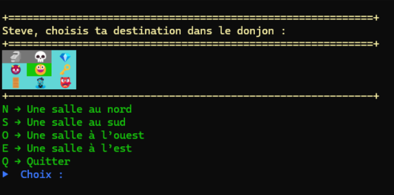
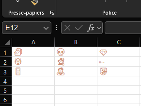
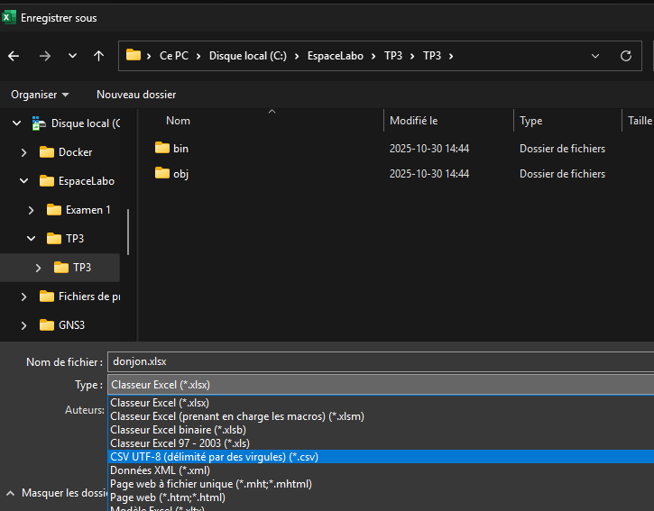
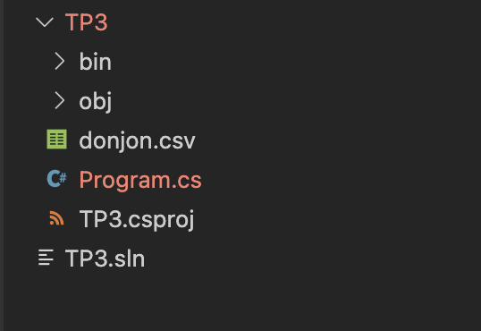
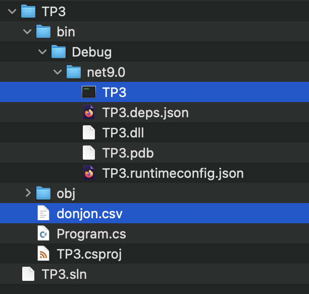

# 🧪 TP3 – Super RPG Infini

---

## 🎯 Objectif du TP3

Bâtir, en console C#, un petit jeu en deux parties :

### Partie 1 – Navigation dans un donjon
- 🏰 **Un donjon 3x3** représenté par une grille
- 👣 **Déplacement du joueur** (Nord, Sud, Est, Ouest)
- ✅ **Suivi des salles visitées**
- 🎭 **Affichage de la position du joueur** et du donjon en console
- 🔄 **Boucle de navigation** avec option *Quitter*
- 🏆 **Fin de partie**



---

### Partie 2 – Créer de nouveaux donjons
- Préparer le fichier donjon.csv
- Charger le nouveau donjon

---


## 🔹 Progression

##### Partie 1 – Donjon
1. Définir les variables et le tableau du donjon  
2. Afficher le donjon avec la position du joueur  
3. Proposer des déplacements valides (N, S, E, O)  
4. Mettre à jour la position et marquer les salles visitées
5. Créer un menu de navigation complet
6. Fin de la partie

---
## 🏰 Partie 1 – Navigation dans un donjon

---
### Étape 1 — Définir les variables et le tableau du donjon

#### 🎯 Objectif

Mettre en place un **donjon simple sous forme de grille (3x3)** dans lequel le joueur pourra se déplacer.  
Chaque salle est représentée par un emoji pour rendre l’affichage plus visuel.

---


#### 1️⃣ Définir le donjon

On utilise un **tableau à 2 dimensions (`string[,]`)** pour représenter le donjon.  
Chaque case contient un symbole qui représente une salle.

```csharp
// Ajout d'un donjon (3x3)
static string[,] donjon = new string[3, 3]
{
    { "🗿", "💀", "💎" },
    { "👹", "🧙‍", "🗝" },
    { "🚪", "🧟", "👺" }
};
```

👉 Ici le donjon est une **grille de 3 lignes × 3 colonnes**.  
Exemple visuel :

```
🗿   💀   💎
👹   🧙‍   🗝
🚪   🧟   👺
```

---

#### 2️⃣ Suivi des salles visitées

On doit savoir si une salle a déjà été visitée par le joueur ou non.  
On crée donc un **tableau parallèle de booléens (`true` ou `false`)** :

```csharp
// Pour savoir si une pièce a été visitée ou non
static bool[,] donjonVisite = new bool[3, 3];
```

👉 Au départ toutes les cases contiennent `false` (non visitées).  
On mettra `true` lorsqu’un joueur entre dans une salle.

---

#### 3️⃣ Position du joueur

On garde la position du joueur avec deux entiers :

```csharp
// Position du joueur dans le donjon
static int positionLigne = 0, positionColonne = 0;
```

- `positionLigne` → ligne (0 = première ligne, 1 = deuxième, etc.)  
- `positionColonne` → colonne (0 = première colonne, 1 = deuxième, etc.)  

👉 Au départ le joueur est placé en haut à gauche (0,0).

---

#### ✅ Test rapide

Ajoute un affichage temporaire dans `Tests()` :

```csharp
Console.WriteLine("=== Donjon initial ===");
for (int ligne = 0; ligne < donjon.GetLength(0); ligne++)
{
    for (int colonne = 0; colonne < donjon.GetLength(1); colonne++)
    {
        Console.Write(donjon[ligne, colonne] + " ");
    }
    Console.WriteLine();
}

Console.WriteLine($"Position du joueur : ({positionLigne},{positionColonne})");
```

#### 🎬 Résultat attendu

```
=== Donjon initial ===
🗿 💀 💎 
👹 🧙‍ 🗝 
🚪 🧟 👺 
Position du joueur : (0,0)
```

---

👉 Prochaine étape : afficher le donjon **avec la position du joueur mise en évidence** (par exemple avec "😃" à la place de la case).

### Étape 2 — Afficher le donjon avec la position du joueur

#### 🎯 Objectif

Mettre en place une fonction qui permet :

- d’afficher le donjon (3x3) en console  
- de montrer la position du joueur avec un emoji distinct (ex. 😃)  
- de différencier les salles visitées et non visitées  

---

#### 1️⃣ Instructions

1. Parcours toutes les cases du donjon avec **deux boucles imbriquées** (une pour les lignes, une pour les colonnes).  
2. Pour chaque case :  
   - Si la position du joueur correspond à la case (`positionLigne`, `positionColonne`) → affiche un emoji spécial pour représenter le joueur.  
   - Sinon → affiche l’emoji de la salle.  
3. Modifie la couleur ou le style selon que la salle a déjà été visitée (`donjonVisite[ligne, colonne] == true`).  
4. N’oublie pas de revenir à la ligne après chaque rangée pour bien afficher la grille 3x3.  
5. 💡 Astuce : tu peux aussi changer la **couleur de fond** avec `Console.BackgroundColor` pour encore mieux différencier les cases.  

---

#### 2️⃣ Pseudo-code

```pseudo
fonction AfficherDonjon()
    pour ligne de 0 à 2
        pour colonne de 0 à 2
            si (ligne == positionLigne et colonne == positionColonne)
                afficher "emoji joueur"
            sinon si (donjonVisite[ligne, colonne] == vrai)
                afficher "emoji de la salle en mode visité"
            sinon
                afficher "emoji de la salle en mode non visité"
        fin pour
        saut de ligne dans la console
    fin pour
fin fonction
```

---

#### 3️⃣ Test rapide

Dans ta fonction `Tests()` :  

- Marque la salle de départ comme visitée (`donjonVisite[positionLigne, positionColonne] = true`).  
- Appelle `AfficherDonjon()`.  
- Simule la visite d’une autre salle en modifiant `donjonVisite[ligne, colonne]` et affiche de nouveau.  

---

#### 🎬 Résultat attendu

- Le joueur apparaît avec un emoji distinct (😃 par exemple).  
- Les salles visitées apparaissent dans un style différent (ex. gris).  
- Les salles non visitées apparaissent normales (ex. cyan).  
- On peut aussi utiliser une **couleur de fond différente** pour mieux distinguer les cases.  
- La grille 3x3 du donjon est correctement affichée.  

---

### Étape 3 — Afficher les options de déplacement

#### 🎯 Objectif

Permettre au joueur de voir **dans quelles directions il peut se déplacer** à partir de sa position actuelle dans le donjon.

---

#### 1️⃣ Schéma du donjon (coordonnées)

```
    (0, 0) ──► colonne

      │
      ▼
    ligne
```

- `positionLigne` → position verticale (lignes)
- `positionColonne` → position horizontale (colonnes)

---

#### 2️⃣ Instructions

1. Crée une fonction `AfficherOptionsDeplacement()`.
2. Vérifie la position actuelle du joueur avec `positionLigne` et `positionColonne`.
3. Si un déplacement est possible, affiche la direction correspondante :
   - Nord (N) → `positionLigne > 0`
   - Sud (S) → `positionLigne < donjon.GetLength(0) - 1`
   - Ouest (O) → `positionColonne > 0`
   - Est (E) → `positionColonne < donjon.GetLength(1) - 1`
4. Si une direction n’est pas possible (bord du donjon), n’affiche rien pour cette direction.

---

#### 3️⃣ Pseudo-code

```pseudo
fonction AfficherOptionsDeplacement()
    si positionLigne > 0
        afficher "N → Une salle au nord"

    si positionLigne < donjon.GetLength(0) - 1
        afficher "S → Une salle au sud"

    si positionColonne > 0
        afficher "O → Une salle à l’ouest"

    si positionColonne < donjon.GetLength(1) - 1
        afficher "E → Une salle à l’est"
fin fonction
```

---

#### ✅ Test rapide

Ajoute dans ta fonction `Tests()` :

```csharp
AfficherOptionsDeplacement();
```

Déplace manuellement `positionLigne` et `positionColonne` pour vérifier que les directions affichées sont correctes selon la position.

---

#### 🎬 Résultat attendu

- Si le joueur est en haut à gauche `(0,0)` → seulement Est et Sud sont possibles.  
- Si le joueur est au centre `(1,1)` → toutes les directions sont possibles.  
- Si le joueur est en bas à droite `(2,2)` → seulement Nord et Ouest sont possibles.  

### Étape 4 — Menu de navigation

#### 🎯 Objectif

Créer un **menu interactif** permettant au joueur de se déplacer dans le donjon jusqu’à ce qu’il choisisse de quitter.

---


#### 1️⃣ Instructions

Le menu appelle `DeplacerJoueur()`, qui sera créée à l’étape 5. Termine l’étape 5 avant de tester le menu complet.


1. Crée une fonction `MenuNavigation()`.
2. Marque la case de départ comme visitée (`donjonVisite[positionLigne, positionColonne] = true;`).
3. Dans une boucle infinie (`for(;;)` ou `while(true)`), effectue les actions suivantes :  
   - Affiche le donjon (`AfficherDonjon()`)  
   - Affiche les options de déplacement (`AfficherOptionsDeplacement()`)  
   - Affiche l’option `Q → Quitter`  
   - Lis le choix de l’utilisateur  
   - Si choix = `Q` → sors de la fonction  
   - Sinon → appelle `DeplacerJoueur(choix)`  
4. Répète tant que l’utilisateur n’a pas quitté.

---

#### 2️⃣ Pseudo-code

```pseudo
fonction MenuNavigation()
    marquer la case (positionLigne, positionColonne) comme visitée

    répéter indéfiniment
        afficher donjon
        afficher options de déplacement
        afficher "Q → Quitter"

        lire le choix du joueur

        si choix == "Q"
            sortir de la boucle

        sinon
            DeplacerJoueur(choix)

fin fonction
```

---

#### 3️⃣ Test rapide

Ajoute dans `Main()` :

```csharp
MenuNavigation();
```

---

#### 🎬 Résultat attendu

- Le joueur voit le donjon et sa position (`😃`).  
- Les salles visitées changent de couleur (ou état).  
- Les options de déplacement disponibles s’affichent selon la position.  
- Entrer une direction valide → déplace le joueur.  
- Entrer `Q` → quitte la navigation.  


### Étape 5 — Déplacer le joueur

#### 🎯 Objectif

Mettre à jour la **position du joueur** dans le donjon en fonction du choix de direction, et marquer la nouvelle salle comme visitée.

---

#### 1️⃣ Instructions

1. Crée une fonction `DeplacerJoueur(string choix)`.
2. Vérifie la direction choisie (`N`, `S`, `O`, `E`).
3. Mets à jour `positionLigne` ou `positionColonne` seulement si le déplacement est possible (ne pas sortir du donjon).
4. Si le choix est invalide → affiche `"Choix invalide."`.
5. Marque la nouvelle position comme **visitée** dans `donjonVisite`.

---

#### 2️⃣ Pseudo-code

```pseudo
fonction DeplacerJoueur(choix)
    si choix == "N" et positionLigne > 0
        positionLigne--
    sinon si choix == "S" et positionLigne < donjon.GetLength(0) - 1
        positionLigne++
    sinon si choix == "O" et positionColonne > 0
        positionColonne--
    sinon si choix == "E" et positionColonne < donjon.GetLength(1) - 1
        positionColonne++
    sinon
        afficher "Choix invalide"

    donjonVisite[positionLigne, positionColonne] = vrai
fin fonction
```

---

#### 3️⃣ Test rapide

Ajoute dans ta fonction `Tests()` :

```csharp
positionLigne = 1; positionColonne = 1; // départ au centre
AfficherDonjon();

DeplacerJoueur("N"); // vers le nord
AfficherDonjon();

DeplacerJoueur("O"); // vers l’ouest
AfficherDonjon();

DeplacerJoueur("X"); // choix invalide
```

---

#### 🎬 Résultat attendu

- Le joueur (`😃`) se déplace dans le donjon selon les directions valides.  
- Si une case est revisitée → elle reste marquée comme visitée (`donjonVisite[ligne, colonne] = true`).  
- Un choix invalide affiche `"Choix invalide."` et ne déplace pas le joueur.  

### Étape 6 — Fin de la partie

#### 🎯 Objectif

Vérifier si le joueur se trouve sur la case de sortie et s'il possède la clé.

La fonction `FinDePartie()` doit retourner un `bool` : `true` si le joueur gagne, `false` sinon. Le menu doit s’arrêter lorsqu’elle retourne `true`.


---

#### 1️⃣ Instructions
1. Ajoute une variable globale pour savoir si le joueur possède la clé.
```csharp
// Devient true lorsqu'on est sur "🗝"
static bool possedeCle = false;
```
1. 👉 Lorsque tu te déplaces dans la salle contenant `"🗝"`, la variable `possedeCle` devient égale à `true`.
2. Crée une fonction `FinDePartie()`.
3. Vérifie si le joueur est sur la porte de sortie `"🚪"`.
4. Vérifie si le joueur a récupéré la clé (`"🗝"`) pour débarrer la porte.
5. Si le joueur est sur la porte, **mais qu'il n'est pas en possession de la clé**, affiche `"La porte est verrouillée. Vous avez besoin de la clé."`.
6. Si le joueur est sur la porte **et qu'il possède la clé**, affiche un message de victoire `"  🎉 Victoire! 🥳  "` et **retourne la valeur `true`**.


---

#### 2️⃣ Pseudo-code

```pseudo
fonction FinDePartie()
    si donjon[positionLigne, positionColonne] != "🚪"
        retourne faux
    
    si !possedeCle
        afficher "La porte est verrouillée. Vous avez besoin de la clé."
        retourne faux
    sinon
        afficher "  🎉 Victoire! 🥳  "
        retourne vrai
fin fonction
```

---

#### ✅ Test rapide

Ajoute dans ta fonction `Tests()` :

```csharp
possedeCle = false;
positionLigne = 2; positionColonne = 0; // départ sur la porte
FinDePartie(); // On a besoin de la clé

positionLigne = 0; positionColonne = 0; // une position différente de la porte
FinDePartie(); // On n'est pas sur la porte, la fonction n'affiche rien

possedeCle = true;
positionLigne = 2; positionColonne = 0; // départ sur la porte
FinDePartie(); // Victoire!
```

---

#### 🎬 Résultat attendu

- Lorsque le joueur est sur une case différente de `"🚪"`, la fonction n'affiche rien et elle retourne `false`.
- Lorsque le joueur est sur la case `"🚪"`, mais qu'il ne possède pas la `"🗝"`, la fonction affiche que la porte est barrée et elle retourne `false`.  
- Lorsque le joueur est sur la case `"🚪"` et qu'il possède la `"🗝"`, la fonction affiche un message de victoire, elle retourne `true` et le jeu se termine (on quitte la boucle du menu de navigation).
:::danger Attention!
Tu devras placer la fonction `FinDePartie()` au bon endroit dans ta boucle du menu de navigation afin de quitter le jeu lors de la victoire.
:::
---

## 🔹 Progression

##### Partie 2 – Créer de nouveaux donjons
1. Préparer le fichier donjon.csv
2. Charger le nouveau donjon

---
## 🗺️ Partie 2 – Créer de nouveaux donjons

---
### Étape 1 — Préparer le fichier donjon.csv

#### 🎯 Objectif

Mets en place un **fichier CSV (donjon.csv)** dans lequel tu pourras créer de nouvelles cartes pour ton jeu. 

---


#### 1️⃣ Définir le donjon

Reprends le donjon de base.

```csharp
static string[,] donjon = new string[3, 3]
{
    { "🗿", "💀", "💎" },
    { "👹", "🧙‍", "🗝" },
    { "🚪", "🧟", "👺" }
};
```

Tu pourras ensuite le transformer en fichier CSV en utilisant Excel. 

Ajoute chaque emoji dans une cellule d'Excel en commençant par la cellule A1.

Le fichier CSV doit former une grille rectangulaire : chaque ligne contient le même nombre de salles. Prévois aussi une clé et une porte pour pouvoir terminer la partie.

<Row>
<Column>



</Column>
<Column>

</Column>
</Row>


Pour sauvegarder le document, assure-toi de choisir le type de fichier `CSV UTF-8 (délimité par des virgules) (*.csv)`
<Row>
<Column>



</Column>
<Column>

</Column>
</Row>

Pour ce TP, les valeurs du fichier CSV sont séparées par des points-virgules (`;`).


Sauvegarde donjon.csv à la **racine de ton projet** (dans le même dossier que Program.cs)
<Row>
<Column>



</Column>
<Column>

</Column>
</Row>

---

#### ✅ Test rapide

Ajoute à la fonction `Tests()`

```csharp
Console.OutputEncoding = System.Text.Encoding.UTF8;
StreamReader fichierDonjon = new StreamReader("../../../donjon.csv");
Console.WriteLine(fichierDonjon.ReadToEnd());
fichierDonjon.Close();
```

Tu devrais voir un beau donjon d'émojis !

### Étape 2 — Charger le nouveau donjon

#### 🎯 Objectif

Lire le fichier donjon.csv au lancement de l'application et placer le donjon lu dans la variable `string[,] donjon`.

Le donjon doit fonctionner avec des dimensions variables, même lorsqu’il n’est pas carré (ex. 10 lignes × 4 colonnes). L’affichage, les déplacements et le suivi des salles visitées doivent s’adapter automatiquement. **Cette fonctionnalité sera évaluée.**


---


#### 1️⃣ Instructions

1. Crée une fonction `ChargerDonjonCSV()`.
2. Trouve le chemin du projet.
3. Ouvre le fichier donjon.csv.
4. Lis le contenu du fichier.
5. Assigne le contenu du fichier à la variable `string[,] donjon`.

---

#### 2️⃣ Pseudo-code

```pseudo
fonction ChargerDonjonCSV()
    chemin = chemin vers donjon.csv

    lignes = new List<string>();
    ouvrir le fichier

    tant que ce n'est pas la fin du fichier
        lire une ligne du fichier
        ajouter la ligne à la liste `lignes`
    fin tant que

    nbLignes = Compter le nombre de lignes
    nbColonnes = Compter le nombre de colonnes

    réinitialiser la variable globale donjon avec les nouvelles dimensions
    réinitialiser la variable globale donjonVisite avec les nouvelles dimensions

    pour chaque ligne

        récupérer la ligne courante dans la liste
        // séparer les éléments de la ligne
        elements = ligne.split(";")

        pour chaque colonne
            assigner l'élément à la bonne case du donjon
        fin pour
    fin pour

    fermer le fichier
fin fonction
```

---

#### 3️⃣ Trouver le chemin vers le fichier

Pour trouver le chemin du fichier donjon.csv, utilise l'emplacement du programme comme point de départ. Toutefois, le programme est exécuté dans le dossier bin/Debug/net8.0 si tu utilises .NET 8, ou dans bin/Debug/net9.0 si tu utilises .NET 9.
Tu dois donc remonter de trois dossiers en utilisant un chemin relatif.

Le chemin relatif présenté suppose que l’application démarre dans `bin/Debug/net8.0` ou `bin/Debug/net9.0`. Si elle démarre ailleurs, adapte le chemin au dossier d’exécution.


<Row>
<Column>



</Column>
<Column>

</Column>
</Row>

##### Comment faire

```csharp
// new StreamReader() donne l'emplacement du programme compilé
// donc le dossier_tp3/bin/Debug/net8.0/ ou encore dossier_tp3/bin/Debug/net9.0/ 
// on remonte de trois niveaux pour atteindre le dossier du projet
StreamReader objFichier = new StreamReader("../../../donjon.csv");
```

---

#### 4️⃣ Utiliser une liste `List`

##### Référence

Tu peux te référer au besoin à la documentation de [Notions C#](https://info.cegepmontpetit.ca/notions-csharp/documentation/liste-generique-list-t)

:::info C'est quoi une liste
- Une liste est une `collection` de variables ou d'objets. 
- Dans le contexte du cours de 1P6, la liste ressemble beaucoup à un tableau 1D
    - **La différence**, c'est que la **taille du tableau est fixe** dès le départ, alors qu'une **liste s'agrandit** lorsqu'on lui ajoute un item. 
:::

##### Créer une liste
Tu peux créer une nouvelle liste avec le **mot-clé** `new`.
```csharp
List<string> lignesDuFichier = new List<string>();
```
- `List` type utilisé pour créer une liste
- `<string>` type de données contenu dans la liste
    - L'équivalent pour un tableau serait `string[]`
- `new List<string>()` création d'une nouvelle liste
    - L'équivalent pour un tableau serait `new string[taille]`
    - Pour le tableau `taille` doit être connu dès le départ

##### Ajouter des données

Il suffit d'utiliser la fonction `Add`
```csharp
List<string> liste = new List<string>();

liste.Add("nouveau texte dans la liste");
```

##### Lire les données

Tu peux lire les données comme dans un tableau.

L’accès à `liste[1]` suppose que la liste contient déjà au moins deux éléments. Cet exemple illustre la syntaxe, pas une liste déjà remplie.

```csharp
List<int> liste = new List<int>();
// ...
int deuxiemeElement = liste[1]; // pour accéder à l'item à l'index 1

// parcourir la liste pour accéder aux éléments 1 à 1
for(int i = 0; i < liste.Count; i++) 
{
    int element  = liste[i];
}
```

:::info
Pour une liste, `Count` joue le même rôle que `Length` pour un tableau.
:::

##### Besoin d'en savoir plus ?

Pour en savoir plus, consulte la documentation de [Notions C#](https://info.cegepmontpetit.ca/notions-csharp/documentation/liste-generique-list-t)

---

#### ✅ Test rapide

Ajoute dans `Tests()` :

```csharp
ChargerDonjonCSV();
AfficherDonjon();
```
---

#### 🎬 Résultat attendu

- Le nouveau donjon devrait pouvoir s'afficher correctement !


## 🧾 Grille de correction (TP3)

| Partie | Élément de correction | Pondération |
|---|---|---:|
| **Partie 1** | | **60 points** |
| | Afficher le donjon et la position du personnage | 20 points |
| | Menu de navigation complet avec les options de déplacement | 20 points |
| | Déplacement du personnage | 10 points |
| | Fin de la partie (Victoire 🏆 🥳) et validation de la clé | 10 points |
| **Partie 2** | | **40 points** |
| | Lecture et traitement de donjon.csv | 15 points |
| | Utilisation du nouveau donjon et taille dynamique | 25 points |
| **Total** | | **100 points** |

### ✅ Barème

Le tableau ci‑dessous décrit ce que signifient les notes 10 / 8 / 6 / 3 / 0 pour un élément évalué.
🥳
| Niveau | Critères (description) | Note |
|---|---|---:|
| Excellent | Les critères d'évaluation sont atteints et le code est exemplaire : lisible, bien structuré, sans bugs, commentaires appropriés et gestion des cas limites. | 10 |
| Très bien | La plupart des critères d'évaluation sont atteints. Quelques lacunes mineures n'empêchent pas la bonne exécution de la fonctionnalité. | 8 |
| Correct | Plusieurs lacunes sont constatées et nuisent partiellement à l'application (bugs mineurs, code répétitif, validations incomplètes). | 6 |
| Insuffisant | Les lacunes sont telles que l'application ne peut pas fonctionner convenablement (fonction manquante, grosse erreur logique, validations absentes). | 3 |
| Inexistant | Non réalisé : la fonctionnalité est absente ou ne compile pas. | 0 |
