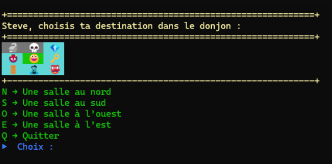
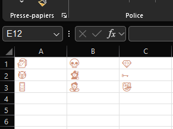
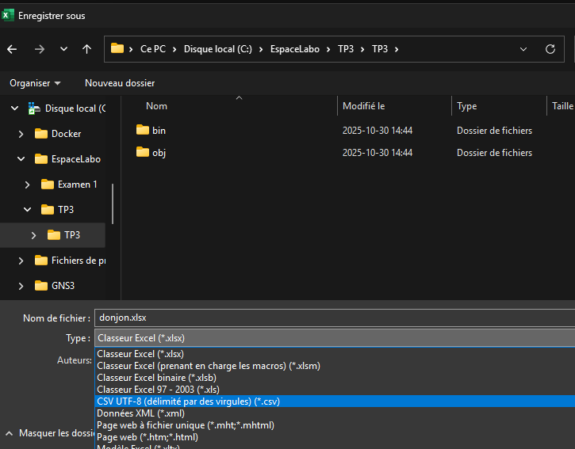
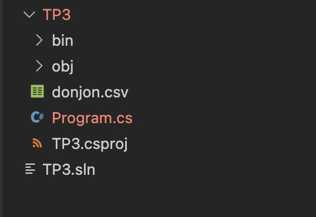
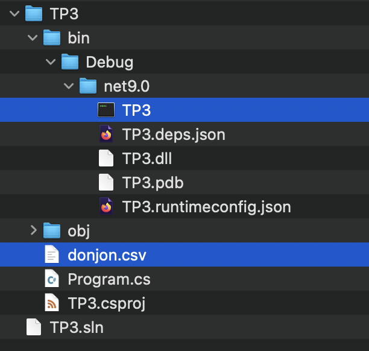
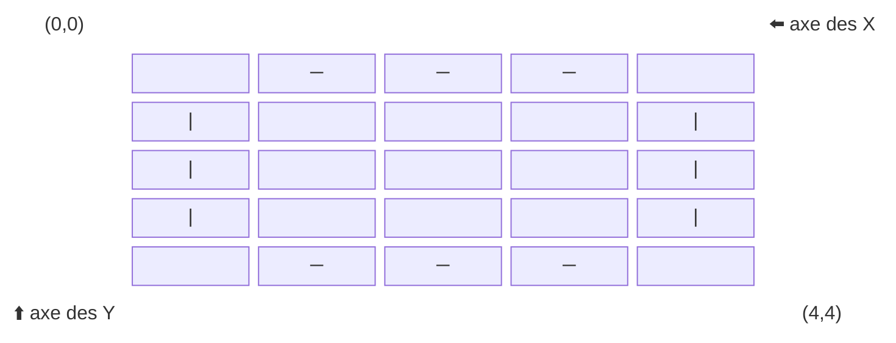
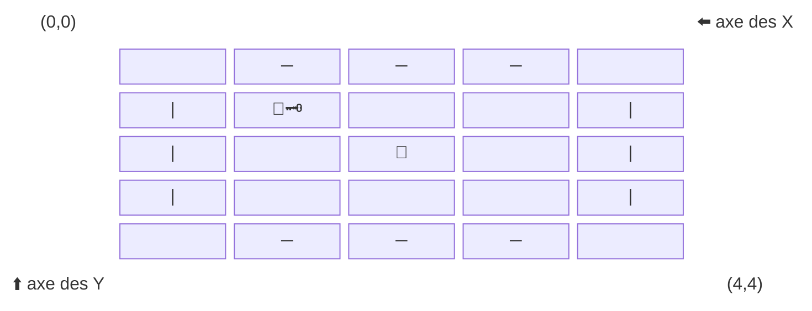

# 🧪 TP3 – Super RPG Infini

---

## 🎯 Objectif du TP3

Bâtir, en console C#, un petit jeu en trois parties :

### Partie 1 – Navigation dans un donjon
- 🏰 **Un donjon 3x3** représenté par une grille
- 👣 **Déplacement du joueur** (Nord, Sud, Est, Ouest)
- ✅ **Suivi des salles visitées**
- 🎭 **Affichage de la position du joueur** et du donjon en console
- 🔄 **Boucle de navigation** avec option *Quitter*
- 🏆 **Fin de partie**



---

### Partie 2 – Créer de nouveaux donjons
- Préparer le fichier donjon.csv
- Charger le nouveau donjon

### Partie 3 – Évènements dans les salles du donjon
- 🎭 **Affichage avancé** du donjon et de la position du joueur
- Évènements dans les salles du donjon
- Résolution des évènements
- Fin de la partie avancée

---


## 🔹 Progression

##### Partie 1 – Donjon
1. Définir les variables et le tableau du donjon  
2. Afficher le donjon avec la position du joueur  
3. Proposer des déplacements valides (N, S, E, O)  
4. Créer un menu de navigation complet
5. Mettre à jour la position et marquer les salles visitées
6. Fin de la partie

---
## 🏰 Partie 1 – Navigation dans un donjon

---
### Étape 1 — Définir les variables et le tableau du donjon

#### 🎯 Objectif

Mettre en place un **donjon simple sous forme de grille (3x3)** dans lequel le joueur pourra se déplacer.  
Chaque salle est représentée par un emoji pour rendre l’affichage plus visuel.

---


#### 1️⃣ Définir le donjon

On utilise un **tableau à 2 dimensions (`string[,]`)** pour représenter le donjon.  
Chaque case contient un symbole qui représente une salle.

```csharp
// Ajout d'un donjon (3x3)
static string[,] donjon = new string[3, 3]
{
    { "🗿", "💀", "💎" },
    { "👹", "🧙", "🗝" },
    { "🚪", "🧟", "👺" }
};
```

👉 Ici le donjon est une **grille de 3 lignes × 3 colonnes**.  
Exemple visuel :

```
🗿   💀   💎
👹   🧙   🗝
🚪   🧟   👺
```

---

#### 2️⃣ Suivi des salles visitées

On doit savoir si une salle a déjà été visitée par le joueur ou non.  
On crée donc un **tableau parallèle de booléens (`true` ou `false`)** :

```csharp
// Pour savoir si une pièce a été visitée ou non
static bool[,] donjonVisite = new bool[3, 3];
```

👉 Au départ toutes les cases contiennent `false` (non visitées).  
On mettra `true` lorsqu’un joueur entre dans une salle.

---

#### 3️⃣ Position du joueur

On garde la position du joueur avec deux entiers :

```csharp
// Position du joueur dans le donjon
static int positionLigne = 0, positionColonne = 0;
```

- `positionLigne` → ligne (0 = première ligne, 1 = deuxième, etc.)  
- `positionColonne` → colonne (0 = première colonne, 1 = deuxième, etc.)  

👉 Au départ le joueur est placé en haut à gauche (0,0).

---

#### ✅ Test rapide

Ajoute un affichage temporaire dans `Tests()` :

```csharp
Console.WriteLine("=== Donjon initial ===");
for (int ligne = 0; ligne < donjon.GetLength(0); ligne++)
{
    for (int colonne = 0; colonne < donjon.GetLength(1); colonne++)
    {
        Console.Write(donjon[ligne, colonne] + " ");
    }
    Console.WriteLine();
}

Console.WriteLine($"Position du joueur : ({positionLigne},{positionColonne})");
```

#### 🎬 Résultat attendu

```
=== Donjon initial ===
🗿 💀 💎 
👹 🧙 🗝
🚪 🧟 👺 
Position du joueur : (0,0)
```

---

👉 Prochaine étape : afficher le donjon **avec la position du joueur mise en évidence** (par exemple avec "😃" à la place de la case).

### Étape 2 — Afficher le donjon avec la position du joueur

#### 🎯 Objectif

Mettre en place une fonction qui permet :

- d’afficher le donjon (3x3) en console  
- de montrer la position du joueur avec un emoji distinct (ex. 😃)  
- de différencier les salles visitées et non visitées  

---

#### 1️⃣ Instructions

1. Parcourir toutes les cases du donjon avec **deux boucles imbriquées** (une pour les lignes, une pour les colonnes).  
2. Pour chaque case :  
   - Si la position du joueur correspond à la case (`positionLigne`, `positionColonne`) → afficher un emoji spécial pour représenter le joueur.  
   - Sinon → afficher l’emoji de la salle.  
3. Modifier la couleur ou le style selon si la salle a déjà été visitée (`donjonVisite[ligne, colonne] == true`).  
4. N’oubliez pas de revenir à la ligne après chaque rangée pour bien afficher la grille 3x3.  
5. 💡 Astuce : vous pouvez aussi changer la **couleur de fond** avec `Console.BackgroundColor` pour encore mieux différencier les cases.  

---

#### 2️⃣ Pseudo-code

```pseudo
fonction AfficherDonjon()
    pour ligne de 0 à 2
        pour colonne de 0 à 2
            si (ligne == positionLigne et colonne == positionColonne)
                afficher "emoji joueur"
            sinon si (donjonVisite[ligne, colonne] == vrai)
                afficher "emoji de la salle en mode visité"
            sinon
                afficher "emoji de la salle en mode non visité"
        fin pour
        saut de ligne dans la console
    fin pour
fin fonction
```

---

#### 3️⃣ Test rapide

Dans votre fonction `Tests()` :  

- Marquez la salle de départ comme visitée (`donjonVisite[positionLigne, positionColonne] = true`).  
- Appelez `AfficherDonjon()`.  
- Simulez la visite d’une autre salle en modifiant `donjonVisite[ligne, colonne]` et affichez de nouveau.  

---

#### 🎬 Résultat attendu

- Le joueur apparaît avec un emoji distinct (😃 par exemple).  
- Les salles visitées apparaissent dans un style différent (ex. gris).  
- Les salles non visitées apparaissent normales (ex. cyan).  
- On peut aussi utiliser une **couleur de fond différente** pour mieux distinguer les cases.  
- La grille 3x3 du donjon est correctement affichée.  

---

### Étape 3 — Afficher les options de déplacement

#### 🎯 Objectif

Permettre au joueur de voir **dans quelles directions il peut se déplacer** à partir de sa position actuelle dans le donjon.

---

#### 1️⃣ Schéma du donjon (coordonnées)

```
    (0, 0) ──► colonne

      │
      ▼
    ligne
```

- `positionLigne` → position verticale (lignes)
- `positionColonne` → position horizontale (colonnes)

---

#### 2️⃣ Instructions

1. Crée une fonction `AfficherOptionsDeplacement()`.
2. Vérifie la position actuelle du joueur avec `positionLigne` et `positionColonne`.
3. Si un déplacement est possible, affiche la direction correspondante :
   - Nord (N) → `positionLigne > 0`
   - Sud (S) → `positionLigne < donjon.GetLength(0) - 1`
   - Ouest (O) → `positionColonne > 0`
   - Est (E) → `positionColonne < donjon.GetLength(1) - 1`
4. Si une direction n’est pas possible (bord du donjon), ne rien afficher pour cette direction.

---

#### 3️⃣ Pseudo-code

```pseudo
fonction AfficherOptionsDeplacement()
    si positionLigne > 0
        afficher "N → Une salle au nord"

    si positionLigne < donjon.GetLength(0) - 1
        afficher "S → Une salle au sud"

    si positionColonne > 0
        afficher "O → Une salle à l’ouest"

    si positionColonne < donjon.GetLength(1) - 1
        afficher "E → Une salle à l’est"
fin fonction
```

---

#### ✅ Test rapide

Ajoute dans ta fonction `Tests()` :

```csharp
AfficherOptionsDeplacement();
```

Déplace manuellement `positionLigne` et `positionColonne` pour vérifier que les directions affichées sont correctes selon la position.

---

#### 🎬 Résultat attendu

- Si le joueur est en haut à gauche `(0,0)` → seulement Est et Sud sont possibles.  
- Si le joueur est au centre `(1,1)` → toutes les directions sont possibles.  
- Si le joueur est en bas à droite `(2,2)` → seulement Nord et Ouest sont possibles.  

### Étape 4 — Menu de navigation

#### 🎯 Objectif

Créer un **menu interactif** permettant au joueur de se déplacer dans le donjon jusqu’à ce qu’il choisisse de quitter.

---


#### 1️⃣ Instructions

1. Créer une fonction `MenuNavigation()`.
2. Marquer la case de départ comme visitée (`donjonVisite[positionLigne, positionColonne] = true;`).
3. Dans une boucle infinie (`for(;;)` ou `while(true)`), faire :  
   - Afficher le donjon (`AfficherDonjon()`)  
   - Afficher les options de déplacement (`AfficherOptionsDeplacement()`)  
   - Afficher l’option `Q → Quitter`  
   - Lire le choix de l’utilisateur  
   - Si choix = `Q` → sortir de la fonction  
   - Sinon → appeler `DeplacerJoueur(choix)`  
4. Répéter tant que l’utilisateur n’a pas quitté.

---

#### 2️⃣ Pseudo-code

```pseudo
fonction MenuNavigation()
    marquer la case (positionLigne, positionColonne) comme visitée

    répéter indéfiniment
        afficher donjon
        afficher options de déplacement
        afficher "Q → Quitter"

        lire le choix du joueur

        si choix == "Q"
            sortir de la boucle

        sinon
            DeplacerJoueur(choix)

fin fonction
```

---

#### 3️⃣ Test rapide

Ajoute dans `Main()` :

```csharp
MenuNavigation();
```

---

#### 🎬 Résultat attendu

- Le joueur voit le donjon et sa position (`😃`).  
- Les salles visitées changent de couleur (ou état).  
- Les options de déplacement disponibles s’affichent selon la position.  
- Entrer une direction valide → déplace le joueur.  
- Entrer `Q` → quitte la navigation.  


### Étape 5 — Déplacer le joueur

#### 🎯 Objectif

Mettre à jour la **position du joueur** dans le donjon en fonction du choix de direction, et marquer la nouvelle salle comme visitée.

---

#### 1️⃣ Instructions

1. Créer une fonction `DeplacerJoueur(string choix)`.
2. Vérifier la direction choisie (`N`, `S`, `O`, `E`).
3. Mettre à jour `positionLigne` ou `positionColonne` seulement si le déplacement est possible (ne pas sortir du donjon).
4. Si le choix est invalide → afficher `"Choix invalide."`.
5. Marquer la nouvelle position comme **visitée** dans `donjonVisite`.

---

#### 2️⃣ Pseudo-code

```pseudo
fonction DeplacerJoueur(choix)
    si choix == "N" et positionLigne > 0
        positionLigne--
    sinon si choix == "S" et positionLigne < donjon.GetLength(0) - 1
        positionLigne++
    sinon si choix == "O" et positionColonne > 0
        positionColonne--
    sinon si choix == "E" et positionColonne < donjon.GetLength(1) - 1
        positionColonne++
    sinon
        afficher "Choix invalide"

    donjonVisite[positionLigne, positionColonne] = vrai
fin fonction
```

---

#### 3️⃣ Test rapide

Ajoute dans ta fonction `Tests()` :

```csharp
positionLigne = 1; positionColonne = 1; // départ au centre
AfficherDonjon();

DeplacerJoueur("N"); // vers le nord
AfficherDonjon();

DeplacerJoueur("O"); // vers l’ouest
AfficherDonjon();

DeplacerJoueur("X"); // choix invalide
```

---

#### 🎬 Résultat attendu

- Le joueur (`😃`) se déplace dans le donjon selon les directions valides.  
- Si une case est revisitée → elle reste marquée comme visitée (`donjonVisite[ligne, colonne] = true`).  
- Un choix invalide affiche `"Choix invalide."` et ne déplace pas le joueur.  

### Étape 6 — Fin de la partie

#### 🎯 Objectif

Vérifier la position du joueur et s'il a récupéré la clé.

---

#### 1️⃣ Instructions
1. Ajouter une variable globale pour savoir si le joueur possède la clé.
```csharp
// Devient true lorsqu'on est sur "🗝"
static bool possedeCle = false;
```
1. 👉 Lorsque l'on se déplace dans la salle contenant `"🗝"`, la variable `possedeCle` devient égale à `true`.
2. Créer une fonction `FinDePartie()`.
3. Vérifier si le joueur est sur la porte de sortie `"🚪"`.
4. Vérifier si le joueur a récupéré la clé pour débarrer la porte `"🗝"`.
5. Si le joueur est sur la porte, **mais il n'est pas en possession de la clé**, afficher `"La porte est verrouillée. Vous avez besoin de la clé."`.
6. Si le joueur est sur la porte **et qu'il possède la clé**, afficher un message de victoire `"  🎉 Victoire! 🥳  "` et **retourne la valeur `true`**.

---

#### 2️⃣ Pseudo-code

```pseudo
fonction FinDePartie()
    si donjon[positionLigne, positionColonne] != "🚪"
        retourne faux
    
    si !possedeCle
        afficher "La porte est verrouillée. Vous avez besoin de la clé."
        retourne faux
    sinon
        afficher "  🎉 Victoire! 🥳  "
        retourne vrai
fin fonction
```

---

#### ✅ Test rapide

Ajoute dans ta fonction `Tests()` :

```csharp
possedeCle = false;
positionLigne = 2; positionColonne = 0; // départ sur la porte
FinDePartie(); // On a besoin de la clé

positionLigne = 0; positionColonne = 0; // une position différente de la porte
FinDePartie(); // On n'est pas sur la porte, la fonction n'affiche rien

possedeCle = true;
positionLigne = 2; positionColonne = 0; // départ sur la porte
FinDePartie(); // Victoire!
```

---

#### 🎬 Résultat attendu

- Lorsque le joueur est sur une case différente de `"🚪"`, la fonction n'affiche rien et retourne `false`.
- Lorsque le joueur est sur la case `"🚪"` sans posséder la clé `"🗝"`, la fonction affiche que la porte est verrouillée et retourne `false`.
- Lorsque le joueur est sur la case `"🚪"` et possède la clé `"🗝"`, la fonction affiche un message de victoire et retourne `true`. Le menu doit utiliser ce retour pour terminer la boucle de navigation.
:::danger Attention!
Après chaque déplacement valide, récupère la clé si la salle contient `"🗝"`, puis appelle `FinDePartie()`. Si elle retourne `true`, quitte la boucle de navigation.
:::
---

## 🔹 Progression

##### Partie 2 – Créer de nouveaux donjons
1. Préparer le fichier donjon.csv
2. Charger le nouveau donjon

---
## 🗺️ Partie 2 – Créer de nouveaux donjons

---
### Étape 1 — Préparer le fichier donjon.csv

#### 🎯 Objectif

Mettre en place un **fichier CSV (`donjon.csv`)** dans lequel vous pourrez créer de nouvelles cartes pour votre jeu.

---


#### 1️⃣ Définir le donjon

On reprendra le donjon de base.

```csharp
static string[,] donjon = new string[3, 3]
{
    { "🗿", "💀", "💎" },
    { "👹", "🧙", "🗝" },
    { "🚪", "🧟", "👺" }
};
```

On pourra ensuite le transformer en fichier csv en utilisant Excel. 

Il suffit d'ajouter chaque emoji dans une case d'excel en commençant à la case A1.
<Row>
<Column>



</Column>
<Column>

</Column>
</Row>


Sauvegardez le document en CSV UTF-8. **Dans ce TP, le séparateur choisi est le point-virgule (`;`)** : ouvrez ensuite le fichier dans un éditeur de texte et vérifiez le séparateur réellement écrit par Excel, qui dépend des paramètres régionaux. Remplacez les virgules par des points-virgules au besoin. Le fichier de départ doit contenir :

```text
🗿;💀;💎
👹;🧙;🗝
🚪;🧟;👺
```
<Row>
<Column>



</Column>
<Column>

</Column>
</Row>


Sauvegarder donjon.csv à la **racine de votre projet** (dans le même dossier que Program.cs)
<Row>
<Column>



</Column>
<Column>

</Column>
</Row>

---

#### ✅ Test rapide

Ajouter à la fonction `Tests()`

```csharp
Console.OutputEncoding = System.Text.Encoding.UTF8;
string cheminDonjon = Path.GetFullPath(Path.Combine(AppContext.BaseDirectory, "../../../donjon.csv"));
StreamReader fichierDonjon = new StreamReader(cheminDonjon);
Console.WriteLine(fichierDonjon.ReadToEnd());
fichierDonjon.Close();
```

Vous devriez voir un beau donjon d'émojis!

### Étape 2 — Charger le nouveau donjon

#### 🎯 Objectif

Lire le fichier donjon.csv au lancement de l'application et placer le donjon lu dans la variable `string[,] donjon`.

---


#### 1️⃣ Instructions

1. Créer une fonction `ChargerDonjonCSV()`.
2. Trouver le chemin du projet.
3. Ouvrir le fichier donjon.csv.
4. Lire le contenu du fichier.
5. Assigner le contenu du fichier à la variable `string[,] donjon`.

Avant de créer les tableaux, vérifier que le fichier existe, qu'il contient au moins une ligne et que toutes les lignes ont le même nombre de cases séparées par `;`. Les cases vides ou contenant un espace sont autorisées. En cas de fichier invalide, afficher un message et ne pas démarrer la navigation. Après un chargement réussi, remettre la position à `(0,0)`, `possedeCle` à `false` et créer `donjonVisite` aux mêmes dimensions que `donjon`.

---

#### 2️⃣ Pseudo-code

```pseudo
fonction ChargerDonjonCSV()
    chemin = chemin vers donjon.csv

    lignes = new List<string>();
    ouvrir le fichier

    tant que ce n'est pas la fin du fichier
        lire une ligne du fichier
        ajouter la ligne à la liste `lignes`
    fin tant que

    nbLignes = Compter le nombre de lignes
    nbColonnes = Compter le nombre de colonnes

    réinitialiser la variable globale donjon avec les nouvelles dimensions
    réinitialiser la variable globale donjonVisite avec les nouvelles dimensions

    pour chaque ligne

        récupérer la ligne courante dans la liste
        // séparer les éléments de la ligne
        elements = ligne.Split(';')

        pour chaque colonne
            assigner l'élément à la bonne case du donjon
        fin pour
    fin pour

    fermer le fichier
fin fonction
```

---

#### 3️⃣ Trouver le chemin vers le fichier

Un chemin relatif est résolu à partir du **répertoire de travail courant**, qui peut varier selon la façon de lancer le programme. Pour ce TP, nous partirons explicitement du dossier de l'exécutable avec `AppContext.BaseDirectory`. Dans la structure de sortie habituelle `bin/Debug/netX.0/`, remonter de trois niveaux mène au dossier du projet qui contient `donjon.csv`.

<Row>
<Column>



</Column>
<Column>

</Column>
</Row>

##### Comment faire

```csharp
// Dans la structure bin/Debug/netX.0/, remonter vers le dossier du projet
string cheminDonjon = Path.GetFullPath(Path.Combine(AppContext.BaseDirectory, "../../../donjon.csv"));
StreamReader objFichier = new StreamReader(cheminDonjon);
```

---

#### 4️⃣ Utiliser une liste `List`

##### Référence

Vous pouvez vous référer au besoin à la documentation de [Notions C#](https://info.cegepmontpetit.ca/notions-csharp/documentation/liste-generique-list-t)

:::info C'est quoi une liste
- Une liste est une `collection` de variables ou d'objets. 
- Dans le contexte du cours de 1P6, la liste ressemble beaucoup à un tableau 1D
    - **La différence** c'est que la **taille du tableau est fixe** dès le départ, alors qu'une **liste s'agrandit** lorsqu'on lui ajoute un item.
:::

##### Créer une liste
On crée une nouvelle liste avec le **mot clé** `new` :
```csharp
List<string> lignesDuFichier = new List<string>();
```
- `List` type utilisé pour créer une liste
- `<string>` type de données contenu dans la liste
    - L'équivalent pour un tableau serait `string[]`
- `new List<string>()` création d'une nouvelle liste
    - L'équivalent pour un tableau serait `new string[taille]`
    - Pour le tableau `taille` doit être connue dès le départ

##### Ajouter des données

Il suffit d'utiliser la fonction `Add`
```csharp
List<string> liste = new List<string>();

liste.Add("nouveau texte dans la liste");
```

##### Lire les données

On peut lire les données comme dans un tableau
```csharp
List<int> liste = new List<int>();
liste.Add(10);
liste.Add(20);
int deuxiemeElement = liste[1]; // 20, l'élément à l'index 1

// parcourir la liste pour accéder aux éléments 1 à 1
for (int i = 0; i < liste.Count; i++)
{
    int element  = liste[i];
}
```

##### Besoin d'en plus?

Pour avoir plus d'informations, vous pouvez vous référer à la documentation de [Notions C#](https://info.cegepmontpetit.ca/notions-csharp/documentation/liste-generique-list-t)

---

#### ✅ Test rapide

Ajoute dans `Tests()` :

```csharp
ChargerDonjonCSV();
AfficherDonjon();
```
---

#### 🎬 Résultat attendu

- Le nouveau donjon devrait pouvoir s'afficher correctement!


## 🔹 Progression

##### Partie 3 – Évènements
1. Initialiser le personnage.
2. Déclencher un événement en arrivant dans une salle.
3. Résoudre les combats et utiliser un item au besoin.
4. Terminer la partie si le joueur n'a plus de PV.
## 🗺️ Partie 3 – Évènements dans les salles du donjon
### ⚠️ Attention - Temps de travail
:::danger ‼️ Temps de travail! ⚠️
**Attention**, la partie est plus longue que la partie 1 et la partie 2. Par contre, la partie 3 compte pour une moins grande partie de la note du travail.

>Partie 1 : 50 % de la note → 30 % du temps
>
>Partie 2 : 30 % de la note → 20 % du temps
>
>Partie 3 : **20 % de la note → 50 % du temps**

La partie 3 est volontairement plus longue, alors il devrait être "facile" de faire 80% du TP et les derniers 20% demandent 
beaucoup plus d'efforts. Ainsi, **il peut être normal de ne pas compléter la totalité de la partie 3**.
:::

### Étape 1 — Initialiser le personnage

:::info Personnage
Tout comme au **TP2**, nous allons initialiser notre personnage et **vous aurez le choix d'utiliser votre TP1 et votre TP2** ou encore d'**utiliser directement les variables globales** pour initialiser votre personnage.
:::

#### 1️⃣ Dans Main

Appeler la fonction `InitialiserPersonnage()` :

```csharp
static void Main(string[] args)
{
    InitialiserPersonnage();
}
```

---

#### 2️⃣ Fonction `InitialiserPersonnage`

Crée la fonction `InitialiserPersonnage` :

```csharp 
static void InitialiserPersonnage()
{
    // Ici on a le choix :
    // 1. On peut réutiliser notre code fait au TP1
    // 2. ou initialiser simplement les variables du TP1

    // Ici on a encore le choix :
    // 1. On peut réutiliser notre code fait au TP2
    // 2. ou initialiser simplement les variables du TP2
    
}
```
---
#### 3️⃣ Déclarer les variables globales du **`TP1`**

```csharp
//Variable du TP1
static string gNomPersonnage = "";
static int gForce = 10;
static int gIntelligence = 10;
static double gVitesse = 2.0;
static char gClasse = 'M';
static int gPV = 10;
```

---
#### 4️⃣ Variable et constante du **`TP2`**

```csharp
//Variable et constante du TP2
const int VIDE = -1;      // Espace du sac vide

// Sac à dos contenant des indices vers la liste d'équipement
static int[] gSacADos = { VIDE, VIDE, VIDE, VIDE, VIDE };
```
---

### Étape 2 — Déclencher un évènement

#### 🎯 Objectif

Interagir avec les éléments du donjon.

---

#### 1️⃣ Instructions

- Modifier la case de départ du donjon.
- Créer la fonction `GererEvenements`.
- Ajouter les différents évènements.
- Créer la fonction `RechercherEquipementDansSac`.
- Utiliser un item au besoin.
- Créer la fonction `Combat`

---

#### 2️⃣ Modifier la case de départ
Assurez-vous que la case de départ du donjon (0,0) soit une case vide `""`

```csharp
static string[,] donjon = new string[3, 3]
{
    { "", "💀", "💎" },
    { "👹", "🧙", "🗝" },
    { "🚪", "🧟", "👺" }
};
```

Ou encore pour un CSV
```
;💀;💎
👹;🧙;🗝
🚪;🧟;👺
```

#### 3️⃣ Créer `GererEvenements`
Cette fonction détermine quel événement se produit à l'arrivée dans la salle. Appelez-la après un déplacement valide, puis quittez la navigation si la partie est terminée (victoire ou `gPV <= 0`). Dans cette partie du TP, elle gère la clé et la porte : n'appelez plus séparément `FinDePartie()` dans le menu, afin d'éviter un double message.

Ajoutez ce champ à `Program` et remettez-le à `false` au début d'une nouvelle partie :

```csharp
static bool finDuJeu = false;
```

Pour la clé, affectez `true` à `possedeCle`. Pour la porte, affectez à `finDuJeu` le résultat de `FinDePartie()`. Après un combat, si `gPV <= 0`, affectez aussi `true` à `finDuJeu`.

##### Pseudo-Code
```pseudo
fonction GererEvenements()
    
    string evenement = la salle du donjon selon la position du joueur

    selon (evenement)
        cas "🧙":
            // faire le bon traitement selon l'évènement

        // ...
        // faire le traitement de chaque évènement
        // ...

        cas "":
            rien faire
        defaut:
            // ...
            

fin fonction
```

#### 4️⃣ Liste des évènements

<table>
<tbody>
    <tr>
        <th>Texte</th>
        <th>Évènement</th>
    </tr>
    <tr>
        <td> `"🗝"` </td>
        <td> Le personnage récupère la clé </td>
    </tr>
    <tr>
        <td> `"🚪"` </td>
        <td>      
```pseudo
Si le personnage a la clé
    Fin du jeu
Sinon 
    Afficher "La porte est verrouillée. Vous avez besoin de la clé."
````
        </td>
    </tr>
    <tr>
        <td> `"🧙"` </td>
        <td>      
```pseudo
Si le personnage n'est pas un mage
    mettre le nombre de PV de l'ennemi à 5
    Lancer un combat
````
        </td>
    </tr>
    <tr>
        <td> `"🥷"` </td>
        <td>      
```pseudo
Si le personnage n'est pas un voleur
    mettre le nombre de PV de l'ennemi à 10
    Lancer un combat
````
        </td>
    </tr>
    <tr>
        <td> `"🦹"` </td>
        <td>      
```pseudo
Si le personnage n'est pas un guerrier
    mettre le nombre de PV de l'ennemi à 15
    Lancer un combat
````
        </td>
    </tr>
    <tr>
        <td> `"🏝️"` </td>
        <td> Le personnage a trouvé une oasis, il **gagne 5 pv** </td>
    </tr>
    <tr>
        <td> `" "` </td>
        <td>      
```pseudo
bool possedeTorche = RechercherEquipementDansSac(TORCHE)
Si le personnage n'a pas de torche
    Afficher "Il fait trop sombre ici. Outch vous heurtez un mur et perdez 2 points de vie."
    retirer 2 pv au personnage.
````
        </td>
    </tr>
    <tr>
        <td> `""` </td>
        <td> On ne fait rien </td>
    </tr>
    <tr>
        <td> Tous les autres cas </td>
        <td> 
```pseudo
mettre le nombre de PV de l'ennemi à 10
Lancer un combat
````
        </td>
    </tr>
</tbody>
</table>

---

#### 5️⃣ Créer la fonction `RechercherEquipementDansSac`

##### Définir les constantes requises
```csharp
const int EPEE = 0;
const int POTION = 1;
const int RATION = 2;
const int BOUCLIER = 3;
const int ARC_COURT = 4;
const int TORCHE = 6;
const int CAPE = 7;
```

##### Méthode alternative
On peut utiliser un `enum`, les enums servent à regrouper des constantes
```csharp
enum Equipement
{
    EPEE = 0,
    POTION = 1,
    RATION = 2,
    BOUCLIER = 3,
    ARC_COURT = 4,
    TORCHE = 6,
    CAPE = 7
}
```

La différence sera lors de l'utilisation
```csharp
// Avec une constante
bool possedeTorche = RechercherEquipementDansSac(TORCHE);
// Avec l'enum
bool possedeTorche = RechercherEquipementDansSac((int)Equipement.TORCHE);
```

##### Pseudo-code
```pseudo
fonction RechercherEquipementDansSac(equipementRecherche)

    pour i de 0 à taille de gSacADos - 1
        indexEquipement = gSacADos[i]
        si indexEquipement est égal à equipementRecherche
            retourner VRAI
    fin pour

    retourner FAUX
fin fonction
```

#### 6️⃣ Créer la méthode `Combat`
Ajouter une variable globale pour les points de vie de l'ennemi
```csharp
static int ennemiPV = 10;
```

Créer la fonction `Combat()`, pour l'instant nous ne ferons qu'afficher un message pour nos tests.
```csharp
static void Combat()
{
    Console.WriteLine("Début d'un combat contre un ennemi avec " + ennemiPV + " points de vie");
}
```

---

#### ✅ Test rapide

Ajouter dans `Tests()` avec le sac vide, `possedeCle = false` et `finDuJeu = false` :

```csharp
donjon = new string[3, 3]
{
    { "", "🚪", "🗝" },
    { "🧙", "🥷", "🦹" },
    { "👺", "🏝️", " " }
};

gClasse = 'V';
possedeCle = false;
finDuJeu = false;
gSacADos = new int[] { VIDE, VIDE, VIDE, VIDE, VIDE };

for (int rangee = 0; rangee < donjon.GetLength(0); rangee++)
{
    for (int colonne = 0; colonne < donjon.GetLength(1); colonne++)
    {
        positionLigne = rangee;
        positionColonne = colonne;
        GererEvenements();
    }
}

gClasse = 'M';
positionLigne = 1;
positionColonne = 0;
GererEvenements(); // Rien ne s'affiche
positionLigne = 1;
positionColonne = 1;
GererEvenements();
gClasse = 'G';
positionLigne = 1;
positionColonne = 2;
GererEvenements(); // Rien ne s'affiche

positionLigne = 0;
positionColonne = 1;
GererEvenements(); // Fin du jeu
Console.WriteLine("Victoire : " + finDuJeu);

```
---

#### 🎬 Résultat attendu

```bash
La porte est verrouillée. Vous avez besoin de la clé.
Début d'un combat contre un ennemi avec 5 points de vie
Début d'un combat contre un ennemi avec 15 points de vie
Début d'un combat contre un ennemi avec 10 points de vie
Vous avez trouvé une oasis! Vos points de vie augmentent de 5.
Il fait trop sombre ici. Outch vous heurtez un mur et perdez 2 points de vie.
Début d'un combat contre un ennemi avec 10 points de vie
  🎉 Victoire! 🥳
Victoire : True
```

---

### Étape 3 — Faire les combats
#### 🎯 Objectif

Interagir avec les éléments du donjon.

---

#### 1️⃣ Instructions

- Créer la fonction `MenuCombat`.
    - Afficher les bonnes options de combat selon nos items
    - Afficher les bonnes options selon le status du combat
- Lancer un dé
- Lire le choix du joueur
- Utiliser des items
    - Appliquer les effets des items
    - Créer la fonction `RetirerEquipementDansSac`
    - Consommer des potions et des rations
- Résoudre le "round" de combat
    - Ajouter ou Enlever les PV au joueur
    - Enlever les PV à l'ennemi
    - Quitter le combat

---

#### 2️⃣ `MenuCombat()`

```pseudo
fonction MenuCombat
    possedePotion = RechercherEquipementDansSac(POTION);
    possedeRation = RechercherEquipementDansSac(RATION);

    Afficher les PV du joueur
    Afficher les PV de l'ennemi
    Afficher "Options de combat:"

    Si l'ennemi a des PV
        Afficher "A → Attaquer"
        Afficher "F → Fuir"
    Si le joueur possede une potion
        Afficher "P → Utiliser une potion de vie"
    Si le joueur possede une ration
        Afficher "R → Manger une ration"
    Si l'ennemi n'a plus de PV
        Afficher "Q → Quitter"

fin fonction
```

#### 3️⃣ Options `"A → Attaquer"`

| Valeur de base | Modificateur Épée | Modificateur Intelligence |
| -------------- | ----------------- | ------------------------- |
| Le résultat d'un jet de dé | +3 à la valeur du dé | +1 à la valeur du dé pour chaque tranche de 5 d'intelligence |

##### Pseudo-Code
```pseudo
degatsJoueur = jet de dé

Si le joueur possede l'épée
    augmenter degatsJoueur de 3;

modifIntelligence = gIntelligence / 5
augmenter degatsJoueur de la valeur de modifIntelligence;
retire degatsJoueur de ennemiPV
Afficher les dégâts infligés à l'ennemi
```

##### Exemple
```
🎲 → Donne une valeur de 5
dégats = 5
🗡️ → Le joueur possède l'épée
dégats = 5 + 3 = 8
🧠 → Le personnage a 18 d'intelligence
modifIntelligence = 18 / 5 = 3
dégats = 8 + 3 = 11
Le joueur inflige 11 de dégâts à l'ennemi
```

#### 4️⃣ Options `"F → Fuir"`

Pour fuir le combat, il faudra avoir une valeur de fuite d'au moins 12

| Valeur de base | Modificateur Vitesse | Modificateur Cape |
| -------------- | ----------------- | ------------------------- |
| Le résultat d'un jet de dé | la valeur du dé * la vitesse du personnage | +25% à la valeur de fuite |


##### Pseudo-Code
```pseudo
valeurDeFuite = jet de dé

si le joueur possede la cape
    augmenter valeurDeFuite de 25%;

valeurDeFuite = valeurDeFuite * gVitesse
si valeurDeFuite >= 12
    fin du combat
```

#### 5️⃣ Options `"P → Utiliser une potion de vie"` et `"R → Manger une ration"`

Ces deux options fonctionnent de la même façon. Vous devrez créer la fonction `RetirerEquipementDansSac` pour consommer un item.
- Une potion donne 5 PV au joueur
- Une ration donne 4 PV au joueur

`RetirerEquipementDansSac(indexEquipement)` remplace par `VIDE` **une seule case** contenant cet équipement, puis s'arrête. Les autres exemplaires du même objet restent dans le sac.


##### Pseudo-Code (pour une potion)
```pseudo
Si le joueur a une potion
    augmenter le nombre de PV du joueur de 5
    Afficher "Vous utilisez une potion de vie et regagnez 5 points de vie."
    RetirerEquipementDansSac(POTION)
Sinon
    Afficher "Vous n'avez pas de potion de vie."
```

#### 6️⃣ Options `"Q → Quitter"`

Cette option est permise uniquement lorsque `ennemiPV <= 0`. On termine alors le combat et on revient au donjon.

Le personnage peut maintenant se déplacer dans le donjon.

#### 7️⃣ Déroulement du `Combat`

##### Les étapes
Pour chaque ronde de combat
1. Lancer un dé
2. Choisir parmi les options de combat
    - Appliquer les effets du choix
3. Appliquer les dégâts ennemis
    - Appliquer les effets des items
    - Appliquer les effets des choix
4. Répéter à partir de l'étape 1 tant que le combat n'est pas terminé.
---

##### Pseudo-code pour le combat
```pseudo
fonction Combat()
    finDuCombat = FAUX
    Random generateur = new Random();

    tant que finDuCombat est faux

        MenuCombat();

        Lire le choix du joueur
        int de = generateur.Next(1, 7);        

        finDuCombat = RondeCombat(de, choix);

fin fonction
```

##### Pseudo-code pour une ronde de combat
Pour chaque ronde de combat, on retournera `true` si c'est la fin du combat et `false` si le combat doit se poursuivre.

```pseudo
fonction RondeCombat(de, choix)

    const int REQUIS_FUIR = 12;

    possedeBouclier = RechercherEquipementDansSac(BOUCLIER)
    possedeArcCourt = RechercherEquipementDansSac(ARC_COURT)
    possedeEpee = RechercherEquipementDansSac(EPEE)
    possedeCape = RechercherEquipementDansSac(CAPE)
    possedePotion = RechercherEquipementDansSac(POTION)
    possedeRation = RechercherEquipementDansSac(RATION)

    // L'ennemi est en vie au début de la ronde
    bool ennemiVivant = ennemiPV > 0;

    selon le choix
        cas "A"
            si ennemiPV > 0
                Attaquer
        cas "F"
            si ennemiPV > 0
                Tenter de fuir
                si la fuite est réussie
                    retourner VRAI
        cas "P"
            Prendre une potion
        cas "R"
            Prendre une ration
        cas "Q":
            si ennemiPV <= 0
                retourner VRAI
            sinon
                Afficher "Impossible de quitter : l'ennemi est encore en vie."
        cas par défaut
            Afficher "Choix invalide."

    si ennemiVivant
        degatsEnnemi = 3;
        si le joueur possede le bouclier
            diminuer degatsEnnemi de 2

        si l'ennemi n'a plus de PV et que le joueur possede l'arc court
            mettre degatsEnnemi à 0 // Le personnage ne recevra pas de dégats
    
        diminuer les PV du joueur de la valeur de degatsEnnemi
        afficher $"L'ennemi vous inflige {degatsEnnemi} points de dégâts."
    
    si le joueur n'a plus de PV
        afficher un message de défaite (exemple "😿 Vous n'avez plus de PV 😿")
        retourner VRAI

    retourner FAUX

fin fonction
```

#### ✅ Test rapide

Ici il y a beaucoup de facteurs en jeu, il serait donc pertinent de faire des **tests unitaires** pour valider tous les cas, toutefois les tests unitaires seront seulement couverts dans un cours de programmation en 2e session.

Nous testerons les cas un à un avec la fonction `RondeCombat(de, choix)`.

Les situations à tester :
- 🗡️ / pas d'épée
- 🧠 / 0 intelligence
- 🦹 le personnage ne meurt pas / il tombe à 0 PV
- 👹 l'ennemi ne meurt pas / il tombe à 0 PV
- 🛡️ / pas de bouclier
- 🏹 et l'ennemi tombe à 0 PV
- On réussit à fuir / On échoue notre tentative de fuite
- 🧥 / pas de cape magique
- On consomme une potion 🧪
- On consomme une potion une fois que l'ennemi n'a plus de PV
- On consomme une ration 🥖
---

**Ajouter dans `Tests()` :**

```csharp
TestCombat();
```

:::danger Noms de variables
Réutilisez les champs déjà déclarés dans la classe `Program` : ne les déclarez pas une deuxième fois. Les tests ci-dessous utilisent les noms suivants (la vitesse est un `double`) :
```csharp
static int gPV = 2;
static int gIntelligence = 0;
static double gVitesse = 1.0;

static int ennemiPV = 100;
```
:::

Créer `TestCombat()`
<details>

<summary>`TestCombat()`</summary>
```csharp
static void TestCombat()
{
    int espace_vide = -1;

    int[] sacADosVide = new int[] { espace_vide, espace_vide, espace_vide, espace_vide, espace_vide };
    int[] sacADosAvecEpee = new int[] { EPEE, espace_vide, espace_vide, espace_vide, espace_vide };
    int[] sacADosAvecArc = new int[] { ARC_COURT, espace_vide, espace_vide, espace_vide, espace_vide };
    int[] sacADosAvecCape = new int[] { CAPE, espace_vide, espace_vide, espace_vide, espace_vide };
    int[] sacADosAvecBouclier = new int[] { BOUCLIER, espace_vide, espace_vide, espace_vide, espace_vide };
    int[] sacADosAvecPotion = new int[] { POTION, espace_vide, espace_vide, espace_vide, espace_vide };
    int[] sacADosAvecRation = new int[] { RATION, espace_vide, espace_vide, espace_vide, espace_vide };

    Console.WriteLine("Test Attaque Normale: " + (AttaqueNormale() ? "Passé" : "Échoué"));
    Console.WriteLine("Test Attaque Avec Épée: " + (AttaqueAvecEpee() ? "Passé" : "Échoué"));
    Console.WriteLine("Test Attaque Avec Intelligence: " + (AttaqueAvecIntelligence() ? "Passé" : "Échoué"));
    Console.WriteLine("Test Attaque Avec Épée et Intelligence: " + (AttaqueAvecEpeeEtIntelligence() ? "Passé" : "Échoué"));
    Console.WriteLine("Test Attaque Ennemi 0 PV: " + (AttaqueEnnemi0PV() ? "Passé" : "Échoué"));
    Console.WriteLine("Test Attaque Ennemi 0 PV Avec Arc: " + (AttaqueEnnemi0PVAvecArc() ? "Passé" : "Échoué"));
    Console.WriteLine("Test Attaque Joueur 0 PV: " + (AttaqueJoueur0PV() ? "Passé" : "Échoué"));
    Console.WriteLine("Test Attaque Avec Bouclier: " + (AttaqueAvecBouclier() ? "Passé" : "Échoué"));
    Console.WriteLine("Test Fuite Réussie: " + (FuiteReussie() ? "Passé" : "Échoué"));
    Console.WriteLine("Test Fuite Échec: " + (FuiteEchec() ? "Passé" : "Échoué"));
    Console.WriteLine("Test Fuite Échec Avec Bouclier: " + (FuiteEchecAvecBouclier() ? "Passé" : "Échoué"));
    Console.WriteLine("Test Fuite Réussie Avec Cape: " + (FuiteReussieAvecCape() ? "Passé" : "Échoué"));
    Console.WriteLine("Test Fuite Réussie Avec Vitesse: " + (FuiteReussieAvecVitesse() ? "Passé" : "Échoué"));
    Console.WriteLine("Test Fuite Réussie Avec Cape et Vitesse: " + (FuiteReussieAvecCapeEtVitesse() ? "Passé" : "Échoué"));
    Console.WriteLine("Test Utilisation Potion: " + (UtiliserPotion() ? "Passé" : "Échoué"));
    Console.WriteLine("Test Utilisation Potion Avec Ennemi à 0 PV: " + (UtiliserPotionEnnemi0PV() ? "Passé" : "Échoué"));
    Console.WriteLine("Test Utilisation Ration: " + (UtiliserRation() ? "Passé" : "Échoué"));
    Console.WriteLine("Test Utilisation Ration Avec Ennemi à 0 PV: " + (UtiliserRationEnnemi0PV() ? "Passé" : "Échoué"));
    Console.WriteLine("Test Quitter Combat: " + (Quitter() ? "Passé" : "Échoué"));

    Console.ReadLine();

    bool AttaqueNormale()
    {
        // Initialisation du sac à dos
        gSacADos = sacADosVide;

        // Initialisation du joueur
        gPV = 100;
        gIntelligence = 0;
        gVitesse = 1.0;

        ennemiPV = 100;

        int de = 6;

        RondeCombat(de, "A");

        return ennemiPV == 94; // Dégâts attendus: 6
    }

    bool AttaqueAvecEpee()
    {
        // Initialisation du sac à dos
        gSacADos = sacADosAvecEpee;

        // Initialisation du joueur
        gPV = 100;
        gIntelligence = 0;
        gVitesse = 1.0;

        ennemiPV = 100;

        int de = 6;

        RondeCombat(de, "A");

        return ennemiPV == 91; // Dégâts attendus: 9
    }

    bool AttaqueAvecIntelligence()
    {
        // Initialisation du sac à dos
        gSacADos = sacADosVide;

        // Initialisation du joueur
        gPV = 100;
        gIntelligence = 20;
        gVitesse = 1.0;

        ennemiPV = 100;

        int de = 6;

        RondeCombat(de, "A");

        return ennemiPV == 90; // Dégâts attendus: 10
    }

    bool AttaqueAvecEpeeEtIntelligence()
    {
        // Initialisation du sac à dos
        gSacADos = sacADosAvecEpee;

        // Initialisation du joueur
        gPV = 100;
        gIntelligence = 20;
        gVitesse = 1.0;

        ennemiPV = 100;

        int de = 6;

        RondeCombat(de, "A");

        return ennemiPV == 87; // Dégâts attendus: 13
    }

    bool AttaqueEnnemi0PV()
    {
        // Initialisation du sac à dos
        gSacADos = sacADosVide;

        // Initialisation du joueur
        gPV = 100;
        gIntelligence = 0;
        gVitesse = 1.0;

        ennemiPV = 1;

        int de = 6;

        bool finCombat = RondeCombat(de, "A");

        return !finCombat && ennemiPV <= 0 && gPV == 97;
    }

    bool AttaqueEnnemi0PVAvecArc()
    {
        // Initialisation du sac à dos
        gSacADos = sacADosAvecArc;

        // Initialisation du joueur
        gPV = 100;
        gIntelligence = 0;
        gVitesse = 1.0;

        ennemiPV = 1;

        int de = 6;

        bool finCombat = RondeCombat(de, "A");

        return !finCombat && ennemiPV <= 0 && gPV == 100;
    }

    bool AttaqueJoueur0PV()
    {
        // Initialisation du sac à dos
        gSacADos = sacADosVide;

        // Initialisation du joueur
        gPV = 1;
        gIntelligence = 0;
        gVitesse = 1.0;

        ennemiPV = 100;

        int de = 6;

        bool finCombat = RondeCombat(de, "A");

        return finCombat && gPV <= 0;
    }

    bool AttaqueAvecBouclier()
    {
        // Initialisation du sac à dos
        gSacADos = sacADosAvecBouclier;

        // Initialisation du joueur
        gPV = 2;
        gIntelligence = 0;
        gVitesse = 1.0;

        ennemiPV = 100;

        int de = 6;

        bool finCombat = RondeCombat(de, "A");

        return !finCombat && gPV == 1; // Dégâts ennemis réduits de 2
    }

    bool FuiteReussie()
    {
        // Initialisation du sac à dos
        gSacADos = sacADosVide;

        // Initialisation du joueur
        gPV = 100;
        gIntelligence = 0;
        gVitesse = 1.0;

        ennemiPV = 100;

        int de = 12; // je sais, 12 ce n'est pas possible avec un dé 6, mais c'est pour le test

        bool finCombat = RondeCombat(de, "F");

        return finCombat && gPV == 100 && ennemiPV == 100;
    }

    bool FuiteEchec()
    {
        // Initialisation du sac à dos
        gSacADos = sacADosVide;

        // Initialisation du joueur
        gPV = 100;
        gIntelligence = 0;
        gVitesse = 1.0;

        ennemiPV = 100;

        int de = 1;

        bool finCombat = RondeCombat(de, "F");

        return !finCombat && gPV == 97 && ennemiPV == 100;
    }

    bool FuiteEchecAvecBouclier()
    {
        // Initialisation du sac à dos
        gSacADos = sacADosAvecBouclier;

        // Initialisation du joueur
        gPV = 2;
        gIntelligence = 0;
        gVitesse = 1.0;

        ennemiPV = 100;

        int de = 1;

        bool finCombat = RondeCombat(de, "F");

        return !finCombat && gPV == 1;
    }

    bool FuiteReussieAvecCape()
    {
        // Initialisation du sac à dos
        gSacADos = sacADosAvecCape;

        // Initialisation du joueur
        gPV = 100;
        gIntelligence = 0;
        gVitesse = 1.0;

        ennemiPV = 100;

        int de = 10; // je sais, 10 ce n'est pas possible avec un dé 6, mais c'est pour le test

        bool finCombat = RondeCombat(de, "F");

        return finCombat && gPV == 100 && ennemiPV == 100;
    }

    bool FuiteReussieAvecVitesse()
    {
        // Initialisation du sac à dos
        gSacADos = sacADosVide;

        // Initialisation du joueur
        gPV = 100;
        gIntelligence = 0;
        gVitesse = 3.0;

        ennemiPV = 100;

        int de = 4;

        bool finCombat = RondeCombat(de, "F");

        return finCombat && gPV == 100 && ennemiPV == 100;
    }

    bool FuiteReussieAvecCapeEtVitesse()
    {
        // Initialisation du sac à dos
        gSacADos = sacADosAvecCape;

        // Initialisation du joueur
        gPV = 100;
        gIntelligence = 0;
        gVitesse = 2.5;

        ennemiPV = 100;

        int de = 4;

        bool finCombat = RondeCombat(de, "F");

        return finCombat && gPV == 100 && ennemiPV == 100;
    }

    bool UtiliserPotion()
    {
        // Initialisation du sac à dos
        gSacADos = (int[])sacADosAvecPotion.Clone();

        // Initialisation du joueur
        gPV = 1;
        gIntelligence = 0;
        gVitesse = 1.0;

        ennemiPV = 100;

        int de = 6;

        bool finCombat = RondeCombat(de, "P");

        return !finCombat && gPV == 3 && RechercherEquipementDansSac(POTION) == false; // Potion retirée et pv + 5 - 3 dégâts ennemis
    }

    bool UtiliserPotionEnnemi0PV()
    {
        // Initialisation du sac à dos
        gSacADos = sacADosAvecPotion;

        // Initialisation du joueur
        gPV = 1;
        gIntelligence = 0;
        gVitesse = 1.0;

        ennemiPV = 0;

        int de = 6;

        bool finCombat = RondeCombat(de, "P");

        return !finCombat && gPV == 6 && RechercherEquipementDansSac(POTION) == false; // Potion retirée et pv + 5
    }

    bool UtiliserRation()
    {
        // Initialisation du sac à dos
        gSacADos = (int[])sacADosAvecRation.Clone();

        // Initialisation du joueur
        gPV = 1;
        gIntelligence = 0;
        gVitesse = 1.0;

        ennemiPV = 100;

        int de = 6;

        bool finCombat = RondeCombat(de, "R");

        return !finCombat && gPV == 2 && RechercherEquipementDansSac(RATION) == false; // Ration retirée et pv + 4 - 3 dégâts ennemis
    }

    bool UtiliserRationEnnemi0PV()
    {
        // Initialisation du sac à dos
        gSacADos = sacADosAvecRation;

        // Initialisation du joueur
        gPV = 1;
        gIntelligence = 0;
        gVitesse = 1.0;

        ennemiPV = 0;

        int de = 6;

        bool finCombat = RondeCombat(de, "R");

        return !finCombat && gPV == 5 && RechercherEquipementDansSac(RATION) == false; // Ration retirée et pv + 4
    }

    bool Quitter()
    {
        // Initialisation du sac à dos
        gSacADos = sacADosAvecRation;

        // Initialisation du joueur
        gPV = 1;
        gIntelligence = 0;
        gVitesse = 1.0;

        ennemiPV = 0;

        int de = 6;

        bool finCombat = RondeCombat(de, "Q");

        return finCombat;
    }
    
}
```

</details>


#### 🎬 Résultat attendu

:::note
Vous pourriez ajouter des Console.WriteLine() dans les tests.
:::
```bash
Test Attaque Normale: Passé
Test Attaque Avec Épée: Passé
Test Attaque Avec Intelligence: Passé
Test Attaque Avec Épée et Intelligence: Passé
Test Attaque Ennemi 0 PV: Passé
Test Attaque Ennemi 0 PV Avec Arc: Passé
Test Attaque Joueur 0 PV: Passé
Test Attaque Avec Bouclier: Passé
Test Fuite Réussie: Passé
Test Fuite Échec: Passé
Test Fuite Échec Avec Bouclier: Passé
Test Fuite Réussie Avec Cape: Passé
Test Fuite Réussie Avec Vitesse: Passé
Test Fuite Réussie Avec Cape et Vitesse: Passé
Test Utilisation Potion: Passé
Test Utilisation Potion Avec Ennemi à 0 PV: Passé
Test Utilisation Ration: Passé
Test Utilisation Ration Avec Ennemi à 0 PV: Passé
Test Quitter Combat: Passé
```

## 🗺️ Bonus

---

### 🎭 **Affichage avancé**

#### 🎯 Objectif

Afficher le donjon par salle, cacher les salles qui n'ont pas été utilisées, utiliser notre personnage et transporter la clé!

---

#### 1️⃣ Instructions

1. Créer une fonction `AfficherSalle`.
2. Créer une constante pour la taille de la salle
    - `const int TAILLE_SALLE = 5;`
2. Positionnez correctement le curseur dans l'écran.
3. Afficher les murs de la salle.
4. Afficher le personnage.
5. Afficher la clé avec le personnage.
6. Afficher le contenu de la salle.
7. Créer une fonction `AfficherDonjonPlusPlus`.

---

#### 2️⃣ La logique

Une salle de 5 × 5 occupe les coordonnées locales de `0` à `4` sur chaque axe. Le mur du bas et celui de droite sont donc à `TAILLE_SALLE - 1`. Les émojis peuvent occuper plusieurs colonnes selon le terminal; ajustez leur espacement si nécessaire. Pour cacher les salles non visitées, appelez `AfficherSalle` seulement si `donjonVisite[rangee, colonne]` vaut `true`.
Ajouter 2 constantes pour afficher les murs
```csharp
const char MUR_H = '─';
const char MUR_V = '│';
```

##### Étape 1 - Dessiner les murs de la salle
Commençons par uniquement dessiner les murs de la salle.
Exemple pour une salle de 5x5


- `"─"` mur horizontal
- `"|"` mur vertical

##### Étape 2 - Dessiner le contenu de la salle
Ensuite on dessine le contenu de la salle


- `"👹"` le contenu de la salle en position (2,2)
- `"🧙"`le personnage en position (1,1) s'il est présent dans la salle
-  `"🗝"` la clé à côté du personnage s'il est en possession de la clé

---

#### 3️⃣ Pseudo-code
```pseudo
fonction AfficherSalle(rangee, colonne)
    
    depart_x = trouver la position de départ sur les X
    depart_y = trouver la position de départ sur les Y

    personnage = assigner le bon personnage

    pour i de 1 à 3
        Positionner le curseur à (depart_x + i, depart_y)
        Dessiner un mur horizontal
        Positionner le curseur à (depart_x + i, depart_y + TAILLE_SALLE - 1)
        Dessiner un mur horizontal
        Positionner le curseur à (depart_x, depart_y + i)
        Dessiner un mur vertical
        Positionner le curseur à (depart_x + TAILLE_SALLE - 1, depart_y + i)
        Dessiner un mur vertical

    milieu_x = depart_x + TAILLE_SALLE / 2
    milieu_y = depart_y + TAILLE_SALLE / 2

    Positionner le curseur à (milieu_x , milieu_y)
    Dessiner le contenu de la salle

    Si le personnage est dans la salle
        Positionner le curseur à (depart_x + 1, depart_y + 1)
        Afficher le personnage
        Si le personnage possède la clé
            Dessiner la clé
fin fonction
```

#### 4️⃣ Afficher le personnage
Ajouter 3 constantes pour afficher votre personnage dans le donjon
```csharp
const string MAGE = "🧙";
const string VOLEUR = "🥷";
const string GUERRIER = "🦹";
```

Utiliser la bonne constante pour afficher votre personnage selon sa classe

#### 5️⃣ Trouver la position de départ
Considérons que nos points de départ sont le coin supérieur gauche de chacune de nos salles.

Si nous avons un donjon de 2x2 et notre constante `const int TAILLE_SALLE = 5;`, les différents points de départ seraient
 - (0, 0)
 - (5, 0)
 - (0, 5)
 - (5, 5)

Alors le parcours de notre donjon sera 
```pseudo
pour rangée de 0 à nombre de rangées du donjon - 1
    pour colonne de 0 à nombre de colonnes du donjon - 1
        AfficherSalle(rangée, colonne);
    fin pour
fin pour
```

Nous aurons donc les appels à `AfficherSalle` suivant
- AfficherSalle(0,0)
- AfficherSalle(0,1)
- AfficherSalle(1,0)
- AfficherSalle(1,1)

🤔 En sachant que nos salles ont une taille de 5x5 cases dans la console, que **changer de colonne augmente l'axe des X** et que **changer de rangée augmente l'axe des Y**
```text
int departX = ? * TAILLE_SALLE;
int departY = ? * TAILLE_SALLE;
```

---

#### 6️⃣ Positionner le curseur de la console
Pour placer le curseur d'écriture de la console à un emplacement précis, il suffit d'utiliser la fonction `Console.SetCursorPosition` et ensuite on écrit avec `Console.Write`
```csharp
Console.SetCursorPosition(1,1);
Console.Write("🙀");
Console.SetCursorPosition(2,2);
Console.Write("🐈");
Console.SetCursorPosition(1,4);
Console.Write("🐱");
```
Résultat
``` 

 🙀
  🐈

 🐱
```

---

#### 7️⃣ Créer `AfficherDonjonPlusPlus`

Créer une nouvelle fonction `AfficherDonjonPlusPlus()`, nous n'utiliserons plus `AfficherDonjon()`

```pseudo

pour toutes les rangees de donjon
    pour toutes les colonnes de donjon
        AfficherSalle(rangee, colonne)
    fin pour
fin pour
```

---

#### ✅ Test rapide

Ajouter dans `Tests()` :

```csharp

AfficherDonjonPlusPlus();
```
---

#### 🎬 Résultat attendu

- Le nouveau donjon devrait pouvoir s'afficher correctement!

## 🧾 Grille de correction (TP3)

| Partie       | Élément de correction                                          | Pondération    |
|--------------|----------------------------------------------------------------|---------------:|
| **Partie 1** |                                                                | **50 points**  |
|              | Afficher le donjon et la position du personnage                | 15 points      |
|              | Menu de navigation complet avec les options de déplacement     | 15 points      |
|              | Déplacement du personnage                                      | 10 points      |
|              | Fin de la partie (Victoire 🏆 🥳) et validation de la clé       | 10 points      |
| **Partie 2** |                                                                | **30 points**  |
|              | Lecture et traitement de donjon.csv                            | 10 points      |
|              | Utilisation du nouveau donjon et taille dynamique              | 20 points      |
| **Partie 3** |                                                                | **20 points**  |
|              | Déclencher les évènements et mise à jour du personnage         | 10 points      |
|              | Gérer les combats, fuir et consommer des items                | 10 points      |
| **Bonus**    |                                                                | **10 points**  |
|              | Affichage avancé                                               | 5 points       |
|              | Autre amélioration personnelle                                 | 5 points       |
| **Total**    |                                                                | **100 points** |

### ✅ Barème

Le tableau ci‑dessous décrit ce que signifient les notes 10 / 8 / 6 / 3 / 0 pour un élément évalué.
🥳
| Niveau | Critères (description) | Note |
|---|---|---:|
| Excellent | Les critères d'évaluation sont atteints et le code est exemplaire : lisible, bien structuré, sans bugs, commentaires appropriés et gestion des cas limites. | 10 |
| Très bien | La plupart des critères d'évaluation sont atteints. Quelques lacunes mineures n'empêchent pas la bonne exécution de la fonctionnalité. | 8 |
| Correct | Plusieurs lacunes sont constatées et nuisent partiellement à l'application (bugs mineurs, code répétitif, validations incomplètes). | 6 |
| Insuffisant | Les lacunes sont telles que l'application ne peut pas fonctionner convenablement (fonction manquante, grosse erreur logique, validations absentes). | 3 |
| Inexistant | Non réalisé : la fonctionnalité est absente ou ne compile pas. | 0 |
