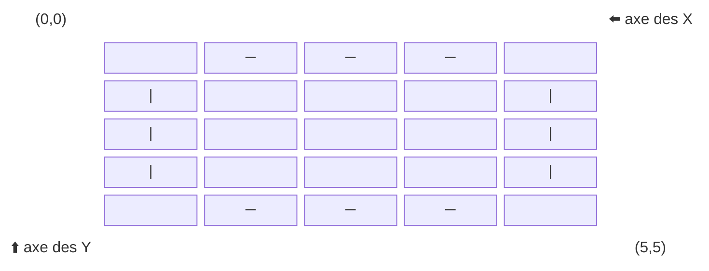
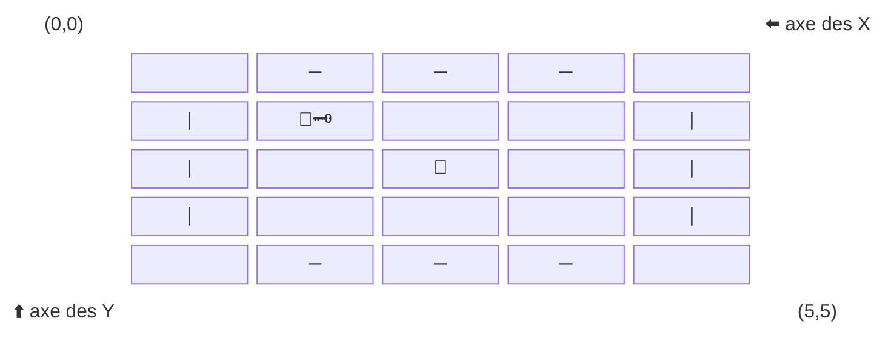

# 🧪 TP4 – Super RPG Infini : Évènements et combats

### Partie 3 – Évènements dans les salles du donjon
- 🎭 **Affichage avancé** du donjon et de la position du joueur
- Évènements dans les salles du donjon
- Résolution des évènements
- Fin de la partie avancée

## 🔹 Progression

##### Partie 3 – Évènements
1. Déclencher un évènement en arrivant dans une salle.
3. Utiliser un item au besoin.
4. Résoudre l'évènement.
5. Fin de la partie par manque de PV.
## 🗺️ Partie 3 – Évènements dans les salles du donjon
### Démarrer le TP4 sans les TP précédents (facultatif)

Si ton TP1, ton TP2 ou ton TP3 n'est pas fonctionnel, tu peux commencer le TP4 avec les données fixes ci-dessous. Elles remplacent seulement les données et l'état de départ; les évènements et les combats restent à programmer dans ce TP.

Copie ces déclarations dans la classe `Program` **à la place des déclarations équivalentes présentées plus bas**. Chaque variable doit être déclarée une seule fois.

```csharp
// Personnage de test
static string gNomPersonnage = "Alex";
static char gClasse = 'G';
static int gPV = 20;
static int gForce = 10;
static int gIntelligence = 10;
static double gVitesse = 2.0;

// Sac de test : identifiants 0 (épée), 1 (potion) et 6 (torche)
const int VIDE = -1;
static int[] gSacADos = { 0, 1, 6, VIDE, VIDE };

// Donjon de test
static string[,] donjon = new string[3, 3]
{
    { "", "🏝️", "🗝" },
    { "🧙", "🚪", " " },
    { "🥷", "🦹", "👹" }
};

static int positionLigne = 0;
static int positionColonne = 0;
static bool possedeCle = false;
static bool finDuJeu = false;
static int ennemiPV = 10;
```

Les valeurs placées dans `gSacADos` sont des **identifiants d'équipement**, pas des positions dans le tableau. Par exemple, la valeur `6` représente la torche.

Pour tester une salle sans menu de navigation ni lecture de CSV, fixe directement `positionLigne` et `positionColonne` dans tes tests, puis appelle ta fonction `GererEvenements()`. Les tests de `RondeCombat()` présentés plus loin peuvent aussi être utilisés avec ce point de départ.

Tu peux également poursuivre ton propre TP3 s'il fonctionne. **Dans les deux cas, seuls les évènements et les combats demandés au TP4 sont évalués; l'initialisation fournie n'accorde pas de points.**

Si tu réutilises le TP3, conserve ses variables `donjon`, `positionLigne`, `positionColonne` et `possedeCle` : ne les déclare pas une deuxième fois. Le test d'évènements du TP4 utilise aussi `finDuJeu` pour vérifier la victoire : déclare cette variable une seule fois si elle n'existe pas déjà. La fonction `FinDePartie()` du TP3 retourne un booléen; les deux doivent respecter la **même condition de victoire**.

---

### Étape 1 — Initialiser le personnage

:::info Personnage
Tout comme au **TP2**, nous allons initialiser notre personnage et **vous aurez le choix d'utiliser votre TP1 et votre TP2** ou encore d'**utiliser directement les variables globales** pour initialiser votre personnage.
:::

#### 1️⃣ Choisir comment initialiser le personnage et le sac

Pour réaliser le TP4, tu as deux possibilités :

**Option A — Réutiliser tes TP précédents**

Si ton TP1 et ton TP2 fonctionnent, tu peux réutiliser ton code pour initialiser le personnage et le sac à dos.

Si tu utilises déjà une fonction `InitialiserPersonnage()`, conserve-la et appelle-la dans `Main()`.

**Option B — Utiliser les données fixes fournies**

Si tu préfères commencer directement le TP4, utilise le bloc de données statiques présenté au début de l'énoncé.

Les variables du personnage et le sac à dos possèdent déjà des valeurs. **Tu n'as donc pas besoin de créer ni d'appeler `InitialiserPersonnage()`.**

Dans les deux cas, utilise les noms des variables montrés dans les exemples du TP4 et évite de déclarer les mêmes variables deux fois. Les déclarations des sections suivantes sont des exemples de remplacement, et non des blocs à ajouter au complet si tu utilises déjà les données fixes.

---

#### 2️⃣ Déclarer les variables globales du **`TP1`**

```csharp
//Variable du TP1
static string gNomPersonnage = "";
static int gForce = 10;
static int gIntelligence = 10;
static double gVitesse = 2.0;
static char gClasse = 'M';
static int gPV = 10;
```

---
#### 3️⃣ Variable et constante du **`TP2`**

```csharp
//Variable et constante du TP2
const int VIDE = -1;      // Espace du sac vide

// Sac à dos contenant des indices vers la liste d'équipement
static int[] gSacADos = { VIDE, VIDE, VIDE, VIDE, VIDE };
```
---

### Étape 2 — Déclencher un évènement

#### 🎯 Objectif

Interagir avec les éléments du donjon.

---

#### 1️⃣ Instructions

- Modifier la case de départ du donjon.
- Créer la fonction `GererEvenements`.
- Ajouter les différents évènements.
- Créer la fonction `RechercherEquipementDansSac`.
- Utiliser un item au besoin.
- Créer la fonction `Combat`

---

#### 2️⃣ Modifier la case de départ
Assure-toi que la case de départ du donjon (0,0) soit vide (`""`). Si tu réutilises le TP3, **modifie le tableau existant**; ne déclare pas un deuxième `donjon`. Si tu utilises les données fixes fournies au début du TP4, la case est déjà vide.

```csharp
static string[,] donjon = new string[3, 3]
{
    { "", "💀", "💎" },
    { "👹", "🧙‍", "🗝" },
    { "🚪", "🧟", "👺" }
};
```

Ou encore pour un CSV
```
;💀;💎
👹;🧙‍;🗝
🚪;🧟;👺
```

#### 3️⃣ Créer `GererEvenements`
Cette fonction vous servira à déterminer quel évènement se produit à l'arrivée dans la salle.

##### Pseudo-Code
```pseudo
fonction GererEvenements()
    
    string evenement = la salle du donjon selon la position du joueur

    selon (evenement)
        cas "🧙":
            // faire le bon traitement selon l'évènement

        // ...
        // faire le traitement de chaque évènement
        // ...

        cas "":
            rien faire
        defaut:
            // ...
            

fin fonction
```

#### 4️⃣ Liste des évènements

<table>
    <tr>
        <th>Texte</th>
        <th>Évènement</th>
    </tr>
    <tr>
        <td> `"🗝"` </td>
        <td> Le personnage récupère la clé </td>
    </tr>
    <tr>
        <td> `"🚪"` </td>
        <td>      
```pseudo
Si le personnage a la clé
    Fin du jeu
Sinon 
    Afficher "La porte est verrouillée. Vous avez besoin de la clé."
````
        </td>
    </tr>
    <tr>
        <td> `"🧙"` </td>
        <td>      
```pseudo
Si le personnage n'est pas un mage
    mettre le nombre de PV de l'ennemi à 5
    Lancer un combat
````
        </td>
    </tr>
    <tr>
        <td> `"🥷"` </td>
        <td>      
```pseudo
Si le personnage n'est pas un voleur
    mettre le nombre de PV de l'ennemi à 10
    Lancer un combat
````
        </td>
    </tr>
    <tr>
        <td> `"🦹"` </td>
        <td>      
```pseudo
Si le personnage n'est pas un guerrier
    mettre le nombre de PV de l'ennemi à 15
    Lancer un combat
````
        </td>
    </tr>
    <tr>
        <td> `"🏝️"` </td>
        <td> Le personnage a trouvé une oasis, il **gagne 5 PV** </td>
    </tr>
    <tr>
        <td> `" "` </td>
        <td>      
```pseudo
bool possedeTorche = RechercherEquipementDansSac(TORCHE)
Si le personnage n'a pas de torche
    Afficher "Il fait trop sombre ici. Outch vous heurtez un mur et perdez 2 points de vie."
    retirer 2 pv au personnage.
````
        </td>
    </tr>
    <tr>
        <td> `""` </td>
        <td> On ne fait rien </td>
    </tr>
    <tr>
        <td> Tous les autres cas </td>
        <td> 
```pseudo
mettre le nombre de PV de l'ennemi à 10
Lancer un combat
````
        </td>
    </tr>
</table>

Attention à la différence entre `""` (chaîne vide : aucun événement) et `" "` (un espace : salle sombre, où la torche est utile).

---

#### 5️⃣ Créer la fonction `RechercherEquipementDansSac`

##### Définir les constantes requises
```csharp
const int EPEE = 0;
const int POTION = 1;
const int RATION = 2;
const int BOUCLIER = 3;
const int ARC_COURT = 4;
const int TORCHE = 6;
const int CAPE = 7;
```

##### Méthode alternative
On peut utiliser un `enum`, les enums servent à regrouper des constantes
```csharp
enum Equipement
{
    EPEE = 0,
    POTION = 1,
    RATION = 2,
    BOUCLIER = 3,
    ARC_COURT = 4,
    TORCHE = 6,
    CAPE = 7
}
```

La différence sera lors de l'utilisation
```csharp
// Avec une constante
bool possedeTorche = RechercherEquipementDansSac(TORCHE);
// Avec l'enum
bool possedeTorche = RechercherEquipementDansSac((int)Equipement.TORCHE);
```

##### Pseudo-code
```pseudo
fonction RechercherEquipementDansSac(equipementRecherche)

    pour i de 0 à taille de gSacADos
        indexEquipement = gSacADos[i]
        si indexEquipement est égal à equipementRecherche
            retourner VRAI
    fin pour

    retourner FAUX
fin fonction
```

#### 6️⃣ Créer la méthode `Combat``
Utilise une variable globale pour les points de vie de l'ennemi. Elle est déjà déclarée dans les données fixes de départ; sinon, déclare-la une seule fois :
```csharp
static int ennemiPV = 10;
```

Créer la fonction `Combat()`, pour l'instant nous ne ferons qu'afficher un message pour nos tests.
```csharp
static void Combat()
{
    Console.WriteLine("Début d'un combat contre un ennemi avec " + ennemiPV + " points de vie");
}
```

La fonction `Combat()` présentée juste au-dessus est une **version temporaire** pour les premiers tests. À l'étape 3, complète cette même fonction plutôt que d'en déclarer une deuxième.

---

#### ✅ Test rapide

Ajouter dans `Tests()` :

```csharp
donjon = new string[3, 3]
{
    { "", "🚪", "🗝" },
    { "🧙", "🥷", "🦹" },
    { "👺", "🏝️", " " }
};

gClasse = 'V';

for (int ligne = 0; ligne < donjon.GetLength(0); ligne++)
{
    for (int colonne = 0; colonne < donjon.GetLength(1); colonne++)
    {
        positionLigne = ligne;
        positionColonne = colonne;
        GererEvenements();
    }
}

gClasse = 'M';
positionLigne = 1;
positionColonne = 0;
GererEvenements(); // Rien ne s'affiche
positionLigne = 1;
positionColonne = 1;
GererEvenements();
gClasse = 'G';
positionLigne = 1;
positionColonne = 2;
GererEvenements(); // Rien ne s'affiche

positionLigne = 0;
positionColonne = 1;
GererEvenements(); // Fin du jeu
Console.WriteLine("Victoire : " + finDuJeu);

```

---

#### 🎬 Résultat attendu

```bash
La porte est verrouillée. Vous avez besoin de la clé.
Début d'un combat contre un ennemi avec 5 points de vie
Début d'un combat contre un ennemi avec 15 points de vie
Début d'un combat contre un ennemi avec 10 points de vie
Vous avez trouvé une oasis! Vos points de vie augmentent de 5.
Il fait trop sombre ici. Outch vous heurtez un mur et perdez 2 points de vie.
Début d'un combat contre un ennemi avec 10 points de vie
Victoire : True
```

---

### Étape 3 — Faire les combats
#### 🎯 Objectif

Interagir avec les éléments du donjon.

---

#### 1️⃣ Instructions

- Créer la fonction `MenuCombat`.
    - Afficher les bonnes options de combat selon nos items
    - Afficher les bonnes options selon le statut du combat
- Lancer un dé
- Lire le choix du joueur
- Utiliser des items
    - Appliquer les effets des items
    - Créer la fonction `RetirerEquipementDansSac`
    - Consommer des potions et des rations
- Résoudre la ronde de combat
    - Ajouter ou Enlever les PV au joueur
    - Enlever les PV à l'ennemi
    - Quitter le combat

---

#### 2️⃣ `MenuCombat()`

```pseudo
fonction MenuCombat
    possedePotion = RechercherEquipementDansSac(POTION);
    possedeRation = RechercherEquipementDansSac(RATION);

    Afficher les PV du joueur
    Afficher les PV de l'ennemi
    Afficher "Options de combat:"

    Si l'ennemi a des PV
        Afficher "A → Attaquer"
        Afficher "F → Fuir"
    Si le joueur possède une potion
        Afficher "P → Utiliser une potion de vie"
    Si le joueur possède une ration
        Afficher "R → Manger une ration"
    Si l'ennemi n'a plus de PV
        Afficher "Q → Quitter"

fin fonction
```

#### 3️⃣ Options `"A → Attaquer"`

| Valeur de base | Modificateur Épée | Modificateur Intelligence |
| -------------- | ----------------- | ------------------------- |
| Le résultat d'un jet de dé | +3 à la valeur du dé | +1 à la valeur du dé pour chaque tranche de 5 d'intelligence |

##### Pseudo-Code
```pseudo
degatsJoueur = jet de dé

Si le joueur possède l'épée
    augmenter degatsJoueur de 3;

modifIntelligence = gIntelligence / 5
augmenter degatsJoueur de la valeur de modifIntelligence;
retire degatsJoueur de ennemiPV
Afficher les dégâts infligés à l'ennemi
```

##### Exemple
```
🎲 → Donne une valeur de 5
dégâts = 5
🗡️ → Le joueur possède l'épée
dégâts = 5 + 3 = 8
🧠 → Le personnage a 18 d'intelligence
modifIntelligence = 18 / 5 = 3
dégâts = 8 + 3 = 11
Le joueur inflige 11 de dégâts à l'ennemi
```

#### 4️⃣ Options `"F → Fuir"`

Pour fuir le combat, il faudra avoir une valeur de fuite d'au moins 12

| Valeur de base | Modificateur Vitesse | Modificateur Cape |
| -------------- | ----------------- | ------------------------- |
| Le résultat d'un jet de dé | la valeur du dé * la vitesse du personnage | +25% à la valeur de fuite |


##### Pseudo-Code
```pseudo
valeurDeFuite = jet de dé

si le joueur possède la cape
    augmenter valeurDeFuite de 25%;

Multiplier valeurDeFuite * gVitesse
si la valeurDeFuite est supérieure ou égale au requis pour fuir (12)
    fin du combat
```

#### 5️⃣ Options `"P → Utiliser une potion de vie"` et `"R → Manger une ration"`

Ces deux options fonctionnent de la même façon. Vous devrez créer la fonction `RetirerEquipementDansSac` pour consommer un item.
- Une potion donne 5 PV au joueur
- Une ration donne 4 PV au joueur


##### Pseudo-Code (pour une potion)
```pseudo
Si le joueur a une potion
    augmenter le nombre de PV du joueur de 5
    Afficher "Vous utilisez une potion de vie et regagnez 5 points de vie."
    RetirerEquipementDansSac(POTION)
Sinon
    Afficher "Vous n'avez pas de potion de vie."
```

#### 6️⃣ Options `"Q → Quitter"`

On termine le combat et on revient au donjon.

Le personnage peut maintenant se déplacer dans le donjon.

#### 7️⃣ Déroulement du `Combat`

##### Les étapes
Pour chaque ronde de combat
1. Lancer un dé
2. Choisir parmi les options de combat
    - Appliquer les effets du choix
3. Appliquer les dégâts ennemis
    - Appliquer les effets des items
    - Appliquer les effets des choix
4. Répéter à partir de l'étape 1 tant que le combat n'est pas terminé.
---

##### Pseudo-code pour le combat
```pseudo
fonction Combat()
    finDuCombat = FAUX
    Random generateur = new Random();

    tant que finDuCombat est faux

        MenuCombat();

        Lire le choix du joueur
        int de = generateur.Next(1, 7);        

        finDuCombat = RondeCombat(de, choix);

fin fonction
```

##### Pseudo-code pour une ronde de combat
Pour chaque ronde de combat, on retournera `true` si c'est la fin du combat et `false` si le combat doit se poursuivre.

```pseudo
fonction RondeCombat(de, choix)

    const int REQUIS_FUIR = 12;

    possedeBouclier = RechercherEquipementDansSac(BOUCLIER)
    possedeArcCourt = RechercherEquipementDansSac(ARC_COURT)
    possedeEpee = RechercherEquipementDansSac(EPEE)
    possedeCape = RechercherEquipementDansSac(CAPE)
    possedePotion = RechercherEquipementDansSac(POTION)
    possedeRation = RechercherEquipementDansSac(RATION)

    // L'ennemi est en vie au début de la ronde
    bool ennemiVivant = ennemiPV > 0;

    selon le choix
        cas "A"
            Attaquer
        cas "F"
            Tenter de fuir
            si la fuite est réussie
                retourner VRAI
        cas "P"
            Prendre une potion
        cas "R"
            Prendre une ration
        cas "Q":
            retourner VRAI
        cas par défaut
            Afficher "Choix invalide."

    si ennemiVivant
        degatsEnnemi = 3;
        si le joueur possède le bouclier
            diminuer degatsEnnemi de 2

        si l'ennemi n'a plus de PV et que le joueur possede l'arc court
            mettre degatsEnnemi à 0 // Le personnage ne recevra pas de dégâts
    
    diminuer les PV du joueur de la valeur de degatsEnnemi
    afficher $"L'ennemi vous inflige {degatsEnnemi} points de dégâts."
    
    si le joueur n'a plus de PV
        afficher un message de défaite (exemple "😿 Vous n'avez plus de PV 😿")
        retourner VRAI

    retourner FAUX

fin fonction
```

#### ✅ Test rapide

Ici il y a beaucoup de facteurs en jeu, il serait donc pertinent de faire des **tests unitaires** pour valider tous les cas, toutefois les tests unitaires seront seulement couverts dans un cours de programmation en 2e session.


Nous ferons presque l'équivalent en testant tous les cas un à un pour s'assurer que nos combats fonctionnent. Nous testerons en utilisant la fonction `RondeCombat(de, choix)`

Voici les cas à tester pour une ronde de combat :
- 🗡️ / pas d'épée
- 🧠 / 0 intelligence
- 🦹 le personnage ne meurt pas / il tombe à 0 PV
- 👹 l'ennemi ne meurt pas / il tombe à 0 PV
- 🛡️ / pas de bouclier
- 🏹 et l'ennemi tombe à 0 PV
- On réussit à fuir / On échoue notre tentative de fuite
- 🧥 / pas de cape magique
- On consomme une potion 🧪
- On consomme une potion une fois que l'ennemi n'a plus de PV
- On consomme une ration 🥖
---

**Ajouter dans `Tests()` :**

```csharp
TestCombat();
```

:::info Variables utilisées dans les tests
Les tests réutilisent les variables globales déjà définies au début du TP4 : `gPV` (`int`), `gIntelligence` (`int`), `gVitesse` (`double`) et `ennemiPV` (`int`). **Ne les déclare pas une deuxième fois.** Si tu réutilises les TP précédents, adapte leurs noms pour qu'ils correspondent à ces exemples.
:::

Créer `TestCombat()`
<details>

<summary>`TestCombat()`</summary>
```csharp
static void TestCombat()
{
    int[] sacADosVide = new int[] { VIDE, VIDE, VIDE, VIDE, VIDE };
    int[] sacADosAvecEpee = new int[] { EPEE, VIDE, VIDE, VIDE, VIDE };
    int[] sacADosAvecArc = new int[] { ARC_COURT, VIDE, VIDE, VIDE, VIDE };
    int[] sacADosAvecCape = new int[] { CAPE, VIDE, VIDE, VIDE, VIDE };
    int[] sacADosAvecBouclier = new int[] { BOUCLIER, VIDE, VIDE, VIDE, VIDE };
    int[] sacADosAvecPotion = new int[] { POTION, VIDE, VIDE, VIDE, VIDE };
    int[] sacADosAvecRation = new int[] { RATION, VIDE, VIDE, VIDE, VIDE };

    Console.WriteLine("Test Attaque Normale: " + (AttaqueNormale() ? "Passé" : "Échoué"));
    Console.WriteLine("Test Attaque Avec Épée: " + (AttaqueAvecEpee() ? "Passé" : "Échoué"));
    Console.WriteLine("Test Attaque Avec Intelligence: " + (AttaqueAvecIntelligence() ? "Passé" : "Échoué"));
    Console.WriteLine("Test Attaque Avec Épée et Intelligence: " + (AttaqueAvecEpeeEtIntelligence() ? "Passé" : "Échoué"));
    Console.WriteLine("Test Attaque Ennemi 0 PV: " + (AttaqueEnnemi0PV() ? "Passé" : "Échoué"));
    Console.WriteLine("Test Attaque Ennemi 0 PV Avec Arc: " + (AttaqueEnnemi0PVAvecArc() ? "Passé" : "Échoué"));
    Console.WriteLine("Test Attaque Joueur 0 PV: " + (AttaqueJoueur0PV() ? "Passé" : "Échoué"));
    Console.WriteLine("Test Attaque Avec Bouclier: " + (AttaqueAvecBouclier() ? "Passé" : "Échoué"));
    Console.WriteLine("Test Fuite Réussie: " + (FuiteReussie() ? "Passé" : "Échoué"));
    Console.WriteLine("Test Fuite Échec: " + (FuiteEchec() ? "Passé" : "Échoué"));
    Console.WriteLine("Test Fuite Échec Avec Bouclier: " + (FuiteEchecAvecBouclier() ? "Passé" : "Échoué"));
    Console.WriteLine("Test Fuite Réussie Avec Cape: " + (FuiteReussieAvecCape() ? "Passé" : "Échoué"));
    Console.WriteLine("Test Fuite Réussie Avec Vitesse: " + (FuiteReussieAvecVitesse() ? "Passé" : "Échoué"));
    Console.WriteLine("Test Fuite Réussie Avec Cape et Vitesse: " + (FuiteReussieAvecCapeEtVitesse() ? "Passé" : "Échoué"));
    Console.WriteLine("Test Utilisation Potion: " + (UtiliserPotion() ? "Passé" : "Échoué"));
    Console.WriteLine("Test Utilisation Potion Avec Ennemi à 0 PV: " + (UtiliserPotionEnnemi0PV() ? "Passé" : "Échoué"));
    Console.WriteLine("Test Utilisation Ration: " + (UtiliserRation() ? "Passé" : "Échoué"));
    Console.WriteLine("Test Utilisation Ration Avec Ennemi à 0 PV: " + (UtiliserRationEnnemi0PV() ? "Passé" : "Échoué"));
    Console.WriteLine("Test Quitter Combat: " + (Quitter() ? "Passé" : "Échoué"));

    Console.ReadLine();

    bool AttaqueNormale()
    {
        // Initialisation du sac à dos
        gSacADos = sacADosVide;

        // Initialisation du joueur
        gPV = 100;
        gIntelligence = 0;
        gVitesse = 1.0;

        ennemiPV = 100;

        int de = 6;

        RondeCombat(de, "A");

        return ennemiPV == 94; // Dégâts attendus: 6
    }

    bool AttaqueAvecEpee()
    {
        // Initialisation du sac à dos
        gSacADos = sacADosAvecEpee;

        // Initialisation du joueur
        gPV = 100;
        gIntelligence = 0;
        gVitesse = 1.0;

        ennemiPV = 100;

        int de = 6;

        RondeCombat(de, "A");

        return ennemiPV == 91; // Dégâts attendus: 9
    }

    bool AttaqueAvecIntelligence()
    {
        // Initialisation du sac à dos
        gSacADos = sacADosVide;

        // Initialisation du joueur
        gPV = 100;
        gIntelligence = 20;
        gVitesse = 1.0;

        ennemiPV = 100;

        int de = 6;

        RondeCombat(de, "A");

        return ennemiPV == 90; // Dégâts attendus: 10
    }

    bool AttaqueAvecEpeeEtIntelligence()
    {
        // Initialisation du sac à dos
        gSacADos = sacADosAvecEpee;

        // Initialisation du joueur
        gPV = 100;
        gIntelligence = 20;
        gVitesse = 1.0;

        ennemiPV = 100;

        int de = 6;

        RondeCombat(de, "A");

        return ennemiPV == 87; // Dégâts attendus: 13
    }

    bool AttaqueEnnemi0PV()
    {
        // Initialisation du sac à dos
        gSacADos = sacADosVide;

        // Initialisation du joueur
        gPV = 100;
        gIntelligence = 0;
        gVitesse = 1.0;

        ennemiPV = 1;

        int de = 6;

        bool finCombat = RondeCombat(de, "A");

        return !finCombat && ennemiPV <= 0 && gPV == 97;
    }

    bool AttaqueEnnemi0PVAvecArc()
    {
        // Initialisation du sac à dos
        gSacADos = sacADosAvecArc;

        // Initialisation du joueur
        gPV = 100;
        gIntelligence = 0;
        gVitesse = 1.0;

        ennemiPV = 1;

        int de = 6;

        bool finCombat = RondeCombat(de, "A");

        return !finCombat && ennemiPV <= 0 && gPV == 100;
    }

    bool AttaqueJoueur0PV()
    {
        // Initialisation du sac à dos
        gSacADos = sacADosVide;

        // Initialisation du joueur
        gPV = 1;
        gIntelligence = 0;
        gVitesse = 1.0;

        ennemiPV = 100;

        int de = 6;

        bool finCombat = RondeCombat(de, "A");

        return finCombat && gPV <= 0;
    }

    bool AttaqueAvecBouclier()
    {
        // Initialisation du sac à dos
        gSacADos = sacADosAvecBouclier;

        // Initialisation du joueur
        gPV = 2;
        gIntelligence = 0;
        gVitesse = 1.0;

        ennemiPV = 100;

        int de = 6;

        bool finCombat = RondeCombat(de, "A");

        return !finCombat && gPV == 1; // Dégâts ennemis réduits de 2
    }

    bool FuiteReussie()
    {
        // Initialisation du sac à dos
        gSacADos = sacADosVide;

        // Initialisation du joueur
        gPV = 100;
        gIntelligence = 0;
        gVitesse = 1.0;

        ennemiPV = 100;

        int de = 12; // je sais, 12 ce n'est pas possible avec un dé 6, mais c'est pour le test

        bool finCombat = RondeCombat(de, "F");

        return finCombat && gPV == 100 && ennemiPV == 100;
    }

    bool FuiteEchec()
    {
        // Initialisation du sac à dos
        gSacADos = sacADosVide;

        // Initialisation du joueur
        gPV = 100;
        gIntelligence = 0;
        gVitesse = 1.0;

        ennemiPV = 100;

        int de = 1;

        bool finCombat = RondeCombat(de, "F");

        return !finCombat && gPV == 97 && ennemiPV == 100;
    }

    bool FuiteEchecAvecBouclier()
    {
        // Initialisation du sac à dos
        gSacADos = sacADosAvecBouclier;

        // Initialisation du joueur
        gPV = 2;
        gIntelligence = 0;
        gVitesse = 1.0;

        ennemiPV = 100;

        int de = 1;

        bool finCombat = RondeCombat(de, "F");

        return !finCombat && gPV == 1;
    }

    bool FuiteReussieAvecCape()
    {
        // Initialisation du sac à dos
        gSacADos = sacADosAvecCape;

        // Initialisation du joueur
        gPV = 100;
        gIntelligence = 0;
        gVitesse = 1.0;

        ennemiPV = 100;

        int de = 10; // je sais, 10 ce n'est pas possible avec un dé 6, mais c'est pour le test

        bool finCombat = RondeCombat(de, "F");

        return finCombat && gPV == 100 && ennemiPV == 100;
    }

    bool FuiteReussieAvecVitesse()
    {
        // Initialisation du sac à dos
        gSacADos = sacADosVide;

        // Initialisation du joueur
        gPV = 100;
        gIntelligence = 0;
        gVitesse = 3.0;

        ennemiPV = 100;

        int de = 4;

        bool finCombat = RondeCombat(de, "F");

        return finCombat && gPV == 100 && ennemiPV == 100;
    }

    bool FuiteReussieAvecCapeEtVitesse()
    {
        // Initialisation du sac à dos
        gSacADos = sacADosAvecCape;

        // Initialisation du joueur
        gPV = 100;
        gIntelligence = 0;
        gVitesse = 2.5;

        ennemiPV = 100;

        int de = 4;

        bool finCombat = RondeCombat(de, "F");

        return finCombat && gPV == 100 && ennemiPV == 100;
    }

    bool UtiliserPotion()
    {
        // Initialisation du sac à dos
        gSacADos = (int[])sacADosAvecPotion.Clone();

        // Initialisation du joueur
        gPV = 1;
        gIntelligence = 0;
        gVitesse = 1.0;

        ennemiPV = 100;

        int de = 6;

        bool finCombat = RondeCombat(de, "P");

        return !finCombat && gPV == 3 && RechercherEquipementDansSac(POTION) == false; // Potion retirée et pv + 5 - 3 dégâts ennemis
    }

    bool UtiliserPotionEnnemi0PV()
    {
        // Initialisation du sac à dos
        gSacADos = sacADosAvecPotion;

        // Initialisation du joueur
        gPV = 1;
        gIntelligence = 0;
        gVitesse = 1.0;

        ennemiPV = 0;

        int de = 6;

        bool finCombat = RondeCombat(de, "P");

        return !finCombat && gPV == 6 && RechercherEquipementDansSac(POTION) == false; // Potion retirée et pv + 5
    }

    bool UtiliserRation()
    {
        // Initialisation du sac à dos
        gSacADos = (int[])sacADosAvecRation.Clone();

        // Initialisation du joueur
        gPV = 1;
        gIntelligence = 0;
        gVitesse = 1.0;

        ennemiPV = 100;

        int de = 6;

        bool finCombat = RondeCombat(de, "R");

        return !finCombat && gPV == 2 && RechercherEquipementDansSac(RATION) == false; // Ration retirée et pv + 4 - 3 dégâts ennemis
    }

    bool UtiliserRationEnnemi0PV()
    {
        // Initialisation du sac à dos
        gSacADos = sacADosAvecRation;

        // Initialisation du joueur
        gPV = 1;
        gIntelligence = 0;
        gVitesse = 1.0;

        ennemiPV = 0;

        int de = 6;

        bool finCombat = RondeCombat(de, "R");

        return !finCombat && gPV == 5 && RechercherEquipementDansSac(RATION) == false; // Potion retirée et pv + 4
    }

    bool Quitter()
    {
        // Initialisation du sac à dos
        gSacADos = sacADosAvecRation;

        // Initialisation du joueur
        gPV = 1;
        gIntelligence = 0;
        gVitesse = 1.0;

        ennemiPV = 0;

        int de = 6;

        bool finCombat = RondeCombat(de, "Q");

        return finCombat;
    }
    
}
```

</details>


#### 🎬 Résultat attendu

:::note
Vous pourriez avec des Console.WriteLine() aux travers des tests
:::
```bash
Test Attaque Normale: Passé
Test Attaque Avec Épée: Passé
Test Attaque Avec Intelligence: Passé
Test Attaque Avec Épée et Intelligence: Passé
Test Attaque Ennemi 0 PV: Passé
Test Attaque Ennemi 0 PV Avec Arc: Passé
Test Attaque Joueur 0 PV: Passé
Test Attaque Avec Bouclier: Passé
Test Fuite Réussie: Passé
Test Fuite Échec: Passé
Test Fuite Échec Avec Bouclier: Passé
Test Fuite Réussie Avec Cape: Passé
Test Fuite Réussie Avec Vitesse: Passé
Test Fuite Réussie Avec Cape et Vitesse: Passé
Test Utilisation Potion: Passé
Test Utilisation Potion Avec Ennemi à 0 PV: Passé
Test Utilisation Ration: Passé
Test Utilisation Ration Avec Ennemi à 0 PV: Passé
Test Quitter Combat: Passé
```

## 🗺️ Bonus

---

### 🎭 **Affichage avancé**

#### 🎯 Objectif

Afficher le donjon par salle, cacher les salles qui n'ont pas été utilisées, utiliser notre personnage et transporter la clé!

---

#### 1️⃣ Instructions

1. Créer une fonction `AfficherSalle`.
2. Créer une constante pour la taille de la salle
    - `const int TAILLE_SALLE = 5;`
2. Positionner correctement le curseur dans l'écran.
3. Afficher les murs de la salle.
4. Afficher le personnage.
5. Afficher la clé avec le personnage.
6. Afficher le contenu de la salle.
7. Créer une fonction `AfficherDonjonPlusPlus`.

---

#### 2️⃣ La logique
Ajouter 2 constantes pour afficher les murs
```csharp
const char MUR_H = '─';
const char MUR_V = '│';
```

##### Étape 1 - Dessiner les murs de la salle
Commençons par uniquement dessiner les murs de la salle.
Exemple pour une salle de 5x5


- `"─"` mur horizontal
- `"|"` mur vertical

##### Étape 2 - Dessiner le contenu de la salle
Ensuite on dessine le contenu de la salle


- `"👹"` le contenu de la salle en position (2,2)
- `"🧙"`le personnage en position (1,1) s'il est présent dans la salle
-  `"🗝"` la clé à côté du personnage s'il est en possession de la clé

---

#### 3️⃣ Pseudo-code
```pseudo
fonction AfficherSalle(rangee, colonne)
    
    depart_x = trouver la position de départ sur les X
    depart_y = trouver la position de départ sur les Y

    personnage = assigner le bon personnage

    pour i de 1 à 3
        Positionner le curseur à (depart_x + i, depart_y)
        Dessiner un mur horizontal
        Positionner le curseur à (depart_x + i, depart_y + taille_de_la_salle)
        Dessiner un mur horizontal
        Positionner le curseur à (depart_x, depart_y + i)
        Dessiner un mur vertical
        Positionner le curseur à (depart_x + taille_de_la_salle, depart_y + i)
        Dessiner un mur vertical

    milieu_x = depart_x + taille_de_la_salle / 2
    milieu_y = depart_y + taille_de_la_salle / 2

    Positionner le curseur à (milieu_x , milieu_y)
    Dessiner le contenu de la salle

    Si le personnage est dans la salle
        Positionner le curseur à (depart_x + 1, depart_y + 1)
        Afficher le personnage
        Si le personnage possède la clé
            Dessiner la clé
fin fonction
```

#### 4️⃣ Afficher le personnage
Ajouter 3 constantes pour afficher votre personnage dans le donjon
```csharp
const string MAGE = "🧙";
const string VOLEUR = "🥷";
const string GUERRIER = "🦹";
```

Utiliser la bonne constante pour afficher votre personnage selon sa classe

#### 5️⃣ Trouver la position de départ
Considérons que le point de départ de chaque salle est son coin supérieur gauche.

Si nous avons un donjon de 2x2 et notre constante `const int TAILLE_SALLE = 5;`, les différents points de départ seraient
 - (0, 0)
 - (5, 0)
 - (0, 5)
 - (5, 5)

Alors le parcours de notre donjon sera 
```pseudo
pour rangée de 0 à nombre de rangées du donjon
    pour colonne de 0 à nombre de colonnes du donjon
        AfficherSalle(rangée, colonne);
    fin pour
fin pour
```

Nous aurons donc les appels à `AfficherSalle` suivants
- AfficherSalle(0,0)
- AfficherSalle(0,1)
- AfficherSalle(1,0)
- AfficherSalle(1,1)

🤔 En sachant que nos salles ont une taille de 5x5 cases dans la console, que **changer de colonne augmente l'axe des X** et que **changer de rangée augmente l'axe des Y**

```csharp🐈
int departX = ? * TAILLE_SALLE;
int departY = ? * TAILLE_SALLE;
```

---

#### 6️⃣ Positionner le curseur de la console
Pour placer le curseur d'écriture de la console à un emplacement précis, il suffit d'utiliser la fonction `Console.SetCursorPosition` et ensuite on écrit avec `Console.Write`
```csharp
Console.SetCursorPosition(1,1);
Console.Write("🙀");
Console.SetCursorPosition(2,2);
Console.Write("🐈");
Console.SetCursorPosition(1,4);
Console.Write("🐱");
```
Résultat
``` 

 🙀   🐱
   🐈
```

---

#### 7️⃣ Créer `AfficherDonjonPlusPlus`

Créer une nouvelle fonction `AfficherDonjonPlusPlus()`, nous n'utiliserons plus `AfficherDonjon()`

```pseudo

pour toutes les rangees de donjon
    pour toutes les colonnes de donjon
        AfficherSalle(rangee, colonne)
    fin pour
fin pour
```

---

#### ✅ Test rapide

Ajouter dans `Tests()` :

```csharp

AfficherDonjonPlusPlus()
```
---

#### 🎬 Résultat attendu

- Le nouveau donjon devrait pouvoir s'afficher correctement!

## 🧾 Grille de correction (TP4)

| Partie | Élément de correction | Pondération |
|---|---|---:|
| **Évènements** | | **50 points** |
| | Déclenchement de GererEvenements() | 10 points |
| | Traitement des évènements (classes, ennemis, oasis, obscurité et torche) | 30 points |
| | RechercherEquipementDansSac() | 10 points |
| **Combats** | | **50 points** |
| | MenuCombat() et affichage des options | 10 points |
| | Attaque : jet de dé, épée et intelligence | 10 points |
| | Fuite : dé, vitesse et cape | 10 points |
| | Potions, rations et RetirerEquipementDansSac() | 10 points |
| | Combat() et RondeCombat() : dégâts, riposte, effets défensifs et fin du combat | 10 points |
| **Total** | | **100 points** |
| **Bonification (hors /100)** | | **+10 points** |
| | Affichage avancé | +5 points |
| | Autre amélioration personnelle | +5 points |

### ✅ Barème

Le tableau ci‑dessous décrit ce que signifient les notes 10 / 8 / 6 / 3 / 0 pour un élément évalué.
🥳
| Niveau | Critères (description) | Note |
|---|---|---:|
| Excellent | Les critères d'évaluation sont atteints et le code est exemplaire : lisible, bien structuré, sans bugs, commentaires appropriés et gestion des cas limites. | 10 |
| Très bien | La plupart des critères d'évaluation sont atteints. Quelques lacunes mineures n'empêchent pas la bonne exécution de la fonctionnalité. | 8 |
| Correct | Plusieurs lacunes sont constatées et nuisent partiellement à l'application (bugs mineurs, code répétitif, validations incomplètes). | 6 |
| Insuffisant | Les lacunes sont telles que l'application ne peut pas fonctionner convenablement (fonction manquante, grosse erreur logique, validations absentes). | 3 |
| Inexistant | Non réalisé : la fonctionnalité est absente ou ne compile pas. | 0 |
